# Rocket Propulsion Lab

**Preliminary rocket-engine analysis you can check.** A dependency-free Python
library, a JSON API and a browser workbench that cover the engine from the
injector to the nozzle exit: combustion chemistry and its losses, heat transfer
through the chamber wall, compressible and real-fluid flow, aerodynamics,
finite burns and an event-safe propulsion provider for orbit propagators.

<p align="center">
  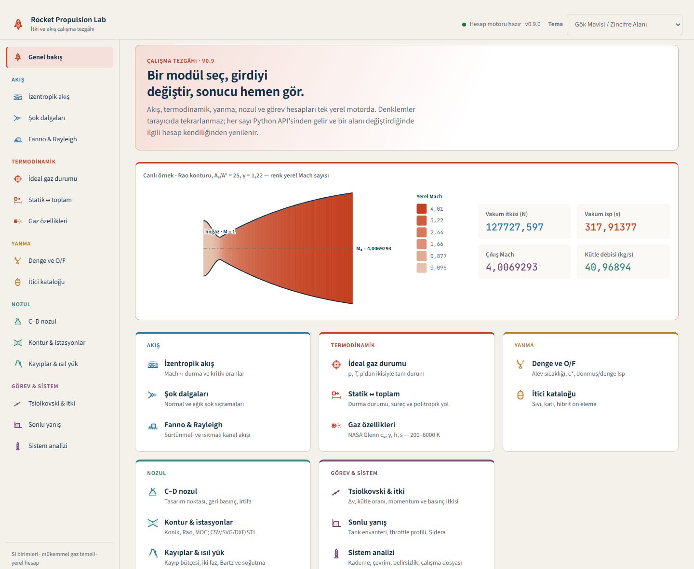
</p>

> Engineering study software, not flight-certified. Python 3.11+, no runtime
> dependencies. Proprietary — all rights reserved (see [Licence](#licence)).

---

## Contents

**Use it** — [Why it exists](#why-it-exists) ·
[Start in one click](#start-in-one-click) ·
[A tour of the workbench](#a-tour-of-the-workbench) ·
[Use it from Python](#use-it-from-python) ·
[Use it from an orbit propagator](#use-it-from-an-orbit-propagator)

**What it computes** — [Combustion and thermochemistry](#combustion-and-thermochemistry) ·
[Heat transfer](#heat-transfer) ·
[Fluids, flow and aerodynamics](#fluids-flow-and-aerodynamics) ·
[Systems and finite burns](#systems-and-finite-burns)

**Why you can trust it** — [Verification evidence](#verification-evidence) ·
[Testing and quality](#testing-and-quality) ·
[Engineering foundations](#engineering-foundations-and-references) ·
[Validation status and limits](#validation-status-and-limits) ·
[How it is built](#how-it-is-built) · [Conventions](#conventions) · [Licence](#licence)

## Why it exists

Preliminary propulsion work usually lives in scattered spreadsheets: one for
isentropic tables, one for the nozzle, one for the rocket equation, none of
them traceable. Rocket Propulsion Lab puts the whole early-design chain in one
place, and keeps every number honest:

- **One engine, many front ends.** The same Python models answer the browser
  workbench, the JSON API, the CLI and your own scripts. The browser never
  re-implements an equation; it only displays what the API returns.
- **Traceable by construction.** Every physical constant is registered once
  with its defining source, models cite the page or equation they implement,
  and inputs fail closed instead of being silently clamped or extrapolated.
- **Checked against the people who wrote the book.** Solvers are compared with
  NASA CEA 3.3.4 runs, NIST WebBook rows, textbook worked examples and their
  own conservation laws; the measured deviation is recorded next to a tolerance
  declared before the comparison (see [Verification evidence](#verification-evidence)).
- **Ready for trajectory software.** Burns become force and mass-flow models
  with analytic partials and event roots that an orbit propagator,
  orbit-determination filter or optimizer can call at every step. The library
  itself computes no orbits; the companion astrodynamics project is Sidera.

## Start in one click

On Windows, double-click **`app.cmd`** in the repository root. It finds Python
3.11+, starts the local calculation server and opens the workbench in your
default browser. Closing the window stops the server; running it again while
the lab is open only re-opens the browser.

On any platform:

```bash
python -m pip install -e .        # no runtime dependencies
rocket-propulsion --open          # or, without installing: PYTHONPATH=src python -m rocket_propulsion.api.server --open
```

The server listens on <http://127.0.0.1:8765> and moves to 8766–8770 when that
port is busy (`--port` pins one). The same calculations are available as
58 `POST /api/v1/...` routes (see [docs/API.md](docs/API.md)) and from the
`rocket-propulsion burn simulate` CLI. Add `?palette=<id>` to the URL to open a
specific colour theme.

## A tour of the workbench

Twenty-nine calculators sit in seven groups, one view at a time. Each group has
its own colour, every result is solved again as soon as you change a field, and
every chart answers the pointer with exact values and marks the state you just
solved.

| Group | Calculators | What you see |
|---|---|---|
| **Flow** | Isentropic flow · normal and oblique shocks · Fanno & Rayleigh | Stagnation and critical ratios with the solved Mach marked on the curves; shock jump ratios across M₁; the θ–β–M diagram with weak and strong branches; sonic-reference lines for friction or heat addition |
| **Thermodynamics** | Ideal-gas state · static ↔ total, process and polytropic path · real fluids · **heat transfer** · species properties | Real-fluid density and cₚ along an isobar with the phase gap kept open; transient wall temperatures and through-wall profiles; coolant h against mass flux for three correlations; radiation-cooled wall temperature against emissivity |
| **Aerodynamics** | NACA airfoil (thin airfoil and panels) · finite wing · supersonic cone and airfoil · boundary layer and entry heating · launch-vehicle body | −Cp along the section and lift curves; spanwise lift and δ against taper; shock-expansion against Ackeret and Busemann; laminar and turbulent skin friction; altitude, deceleration and stagnation heating along an entry; normal force against α and drag components |
| **Combustion** | Equilibrium O/F sweep · CEA-gated rocket performance · **products and efficiency** · propellant catalogue | Frozen vs equilibrium Isp with the optimum O/F; chamber composition; radical fraction at chamber, throat and exit; the Isp loss chain from ODE to delivered with each loss in seconds; H and OH freezing along a finite-rate nozzle |
| **Nozzle** | C–D nozzle with off-design and altitude · contour and stations · **regenerative cooling** · losses and thermal loads | The Mach-coloured flow field; Rao/MOC/conical contours with CSV/SVG/DXF/STL export; hot-wall, cold-wall and coolant temperatures, heat flux and coolant pressure along the chamber; loss budget by term |
| **Mission & system** | Rocket equation and thrust · finite burn · staging, cycle, uncertainty and workspace | Δv against mass ratio; thrust split into momentum and pressure terms; tank inventory and mass/thrust histories; stage mass breakdown; pump vs turbine power; the Δv distribution with P05/P95 |
| **Transients** | Feed and blowdown · electric and pulse mode · uncertainty, scenarios and hot-fire calibration · burn timeline · spacecraft propulsion trade (SASS) | Tank pressure, thrust and remaining propellant over a blowdown; regulator and feed-line operating points; impulse bit against on-time; impulse histograms with P50 and sensitivities; thrust and jettisoned mass over a timeline |

<table>
  <tr>
    <td width="50%">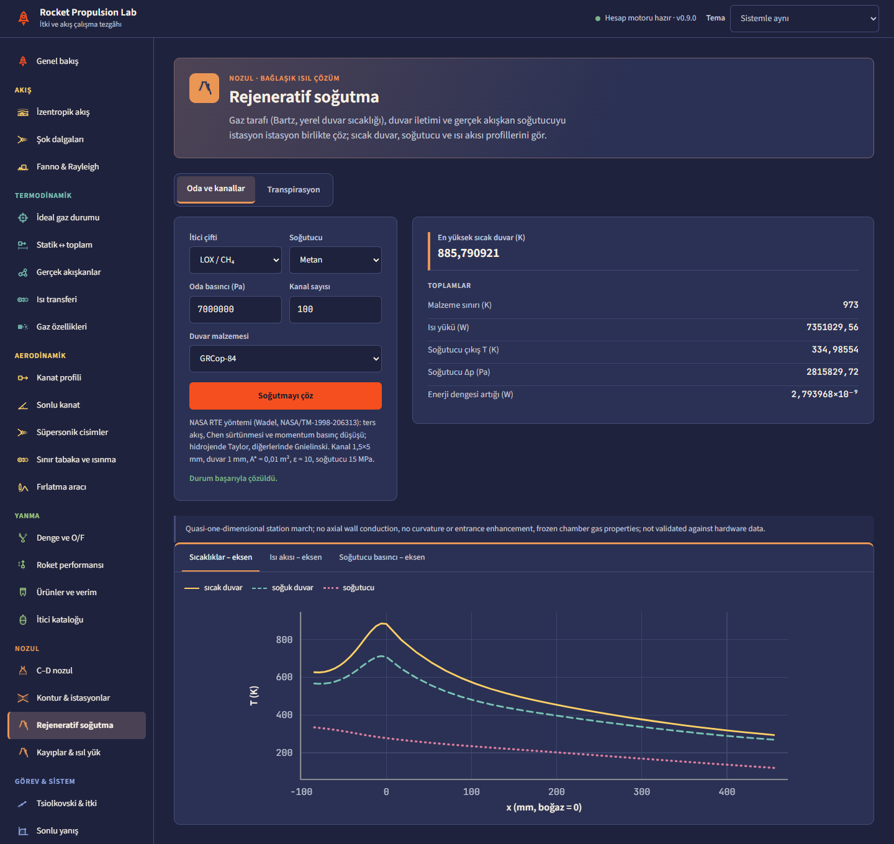<br><sub><b>Regenerative cooling</b> — Bartz gas side, wall conduction and real-fluid methane solved together at every station.</sub></td>
    <td width="50%"><br><sub><b>Combustion products</b> — chamber composition, radicals and the energy held in dissociation.</sub></td>
  </tr>
  <tr>
    <td>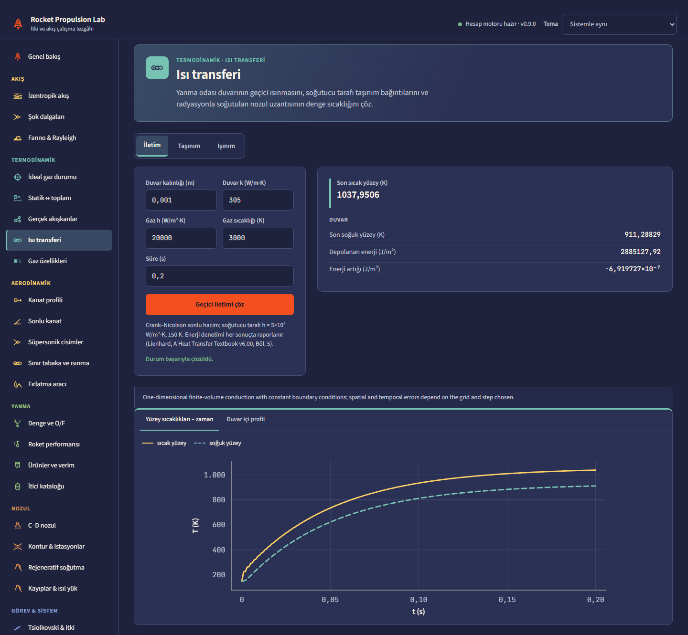<br><sub><b>Heat transfer</b> — transient wall conduction with an energy audit; convection and radiation tabs.</sub></td>
    <td>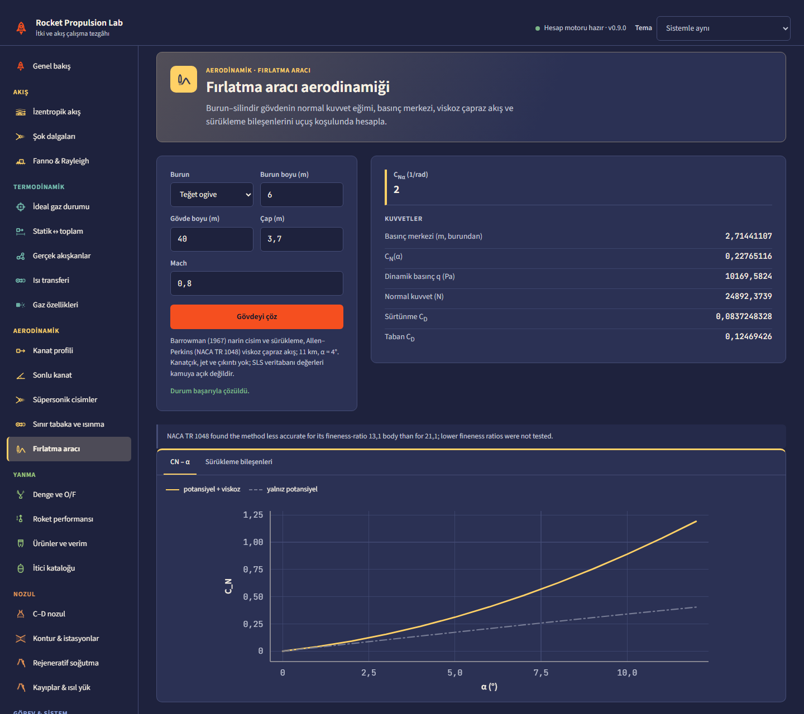<br><sub><b>Launch vehicle</b> — Barrowman normal force with Allen–Perkins viscous cross-flow.</sub></td>
  </tr>
  <tr>
    <td>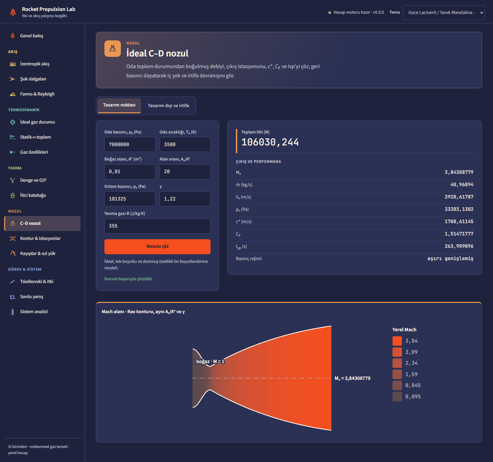<br><sub><b>Nozzle</b> — design point and the Mach field of the same area ratio.</sub></td>
    <td>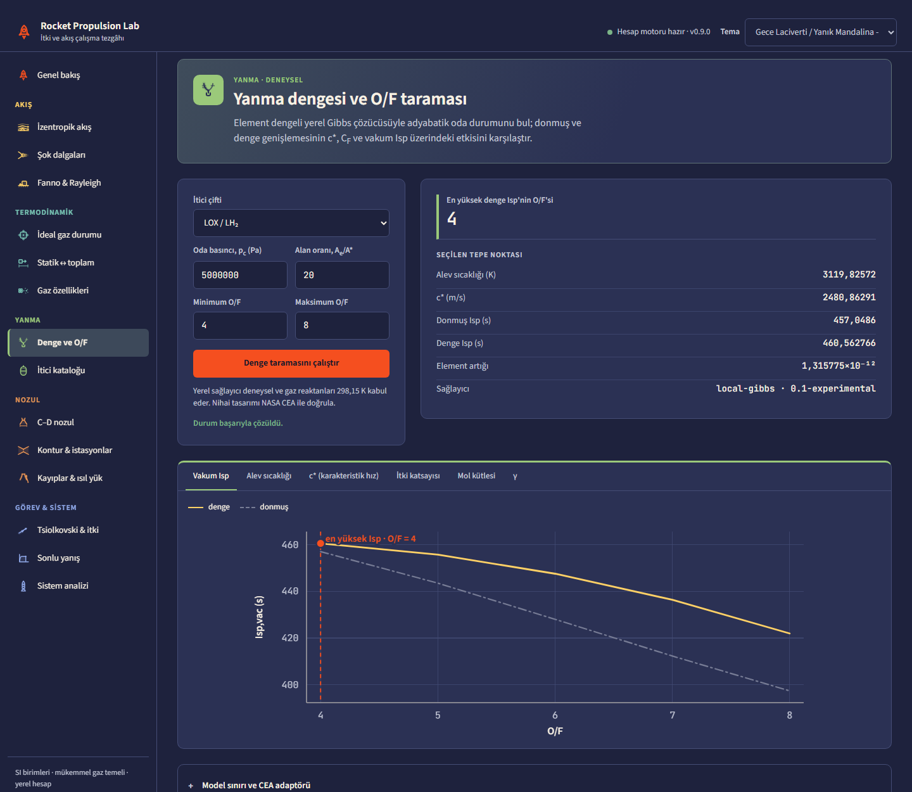<br><sub><b>Equilibrium</b> — frozen vs equilibrium Isp with the optimum O/F.</sub></td>
  </tr>
  <tr>
    <td>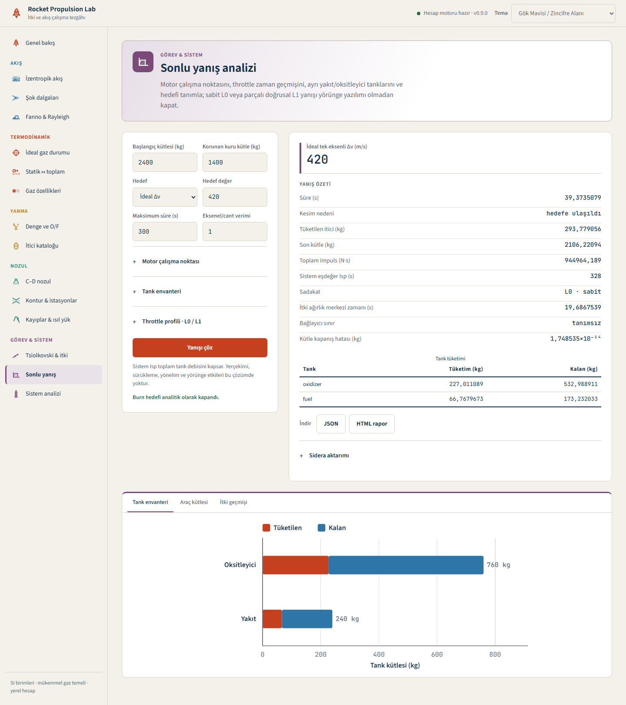<br><sub><b>Finite burn</b> — tank inventory, mass and thrust histories, Sidera export.</sub></td>
    <td>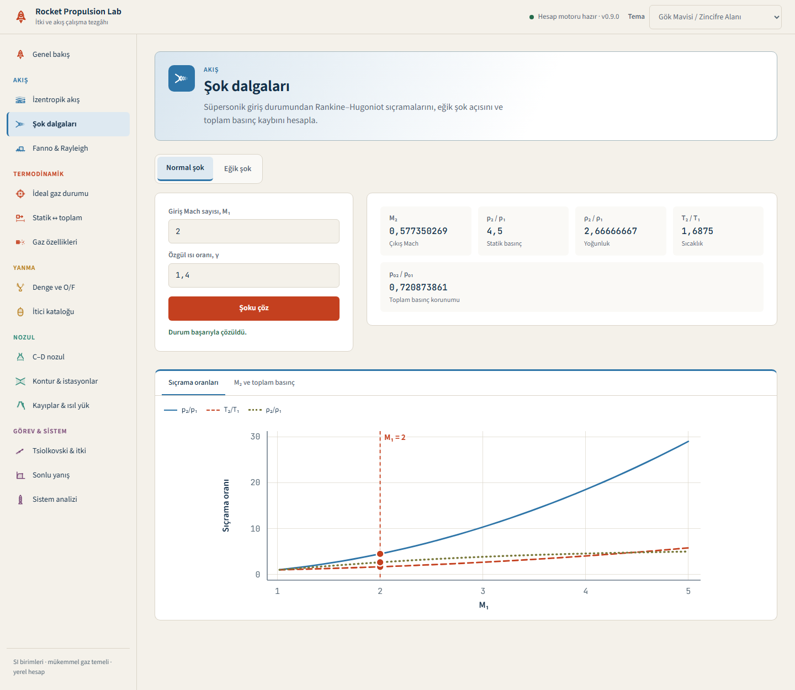<br><sub><b>Shocks</b> — jump ratios across M₁ with the solved state marked.</sub></td>
  </tr>
</table>

<p align="center">
  
  &nbsp;
  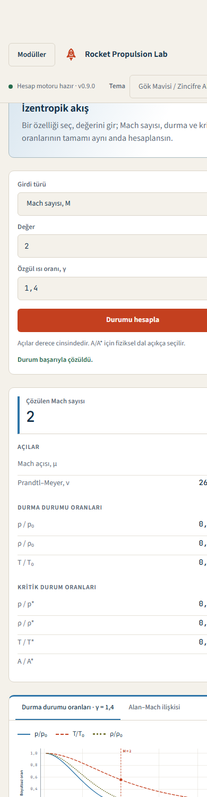
</p>

The workbench is built on the [Sunumatik](https://github.com/ayberkdt/sunumatik)
preset library: palette tokens (56 light and dark palettes with six data
series; the defaults, cerulean-vermilion and midnight-tangerine, pass the
datawiz colour-vision audit), the chart theme with colour-blind safe series
slots and dash patterns, table presets, the focus-layout tab behaviour,
Turkish number formatting, Source Sans 3 / JetBrains Mono and the duotone
propulsion icons. The presets are vendored as rule subsets under
`src/rocket_propulsion/web/vendor/sunumatik`, pinned to a source commit and
SHA-256 hashes in `PROVENANCE.json`
(`python scripts/sync_sunumatik_presets.py --source <checkout>` updates them,
`--check` verifies them).

## Use it from Python

A cooled LOX/CH₄ chamber, solved station by station with the gas side, the
wall and the coolant coupled:

```python
from rocket_propulsion.geometry import generate_nozzle_contour
from rocket_propulsion.heat_transfer.regen_chamber import (
    Coolant, CoolingChannels, hot_gas_from_propellant, solve_regen_chamber,
)

gas = hot_gas_from_propellant(propellant_pair="LOX_CH4", chamber_pressure_pa=7.0e6,
                              throat_radius_of_curvature_m=0.05)
contour = generate_nozzle_contour(contour="conical", throat_area_m2=0.01, area_ratio=10.0,
                                  gamma=gas.gamma, chamber_radius_ratio=2.0, station_count=41)
result = solve_regen_chamber(
    contour=contour, gas=gas, wall_material="grcop-84",
    channels=CoolingChannels(count=100, width_m=1.5e-3, height_m=3.0e-3,
                             hot_wall_thickness_m=1.0e-3),
    coolant=Coolant(fluid="methane", inlet_temperature_k=120.0,
                    inlet_pressure_pa=15.0e6, mass_flow_kg_s=8.6),
)
print(result.maximum_hot_wall_temperature_k, result.total_heat_load_w,
      result.energy_balance_residual_w)
# 912 K against the 973 K GRCop-84 limit, 7.37 MW, residual 9.3e-10 W
```

With 3.5 kg/s instead of 8.6 kg/s the methane leaves the 400 K range of its
viscosity correlation and the solver stops with a `DomainError` that names the
fluid, state and range, rather than extrapolating.

What the combustion products are, how much energy dissociation holds, and
where the Isp goes:

```python
from rocket_propulsion.thermochemistry.combustion_efficiency import (
    combustion_product_report, jannaf_isp_loss_chain,
)

report = combustion_product_report(propellant_pair="LOX_LH2", oxidizer_fuel_ratio=6.0,
                                   chamber_pressure_pa=7.0e6, area_ratio=40.0)
for station in report.stations:                    # chamber, throat, exit
    print(station.name, round(station.temperature_k), station.radical_mole_fraction)
print(report.dissociation.dissociation_fraction)   # 0.144 of the available energy

chain = jannaf_isp_loss_chain(ode_specific_impulse_s=report.vacuum_specific_impulse_s,
                              kinetic_efficiency=0.998, divergence_efficiency=0.985,
                              boundary_layer_decrement_s=3.0,
                              characteristic_velocity_efficiency=0.98)
print(chain.ode_specific_impulse_s, chain.delivered_specific_impulse_s)   # 451.7 -> 432.2 s
```

The radical mole fraction falls from 8.2e-2 in the chamber to 6.5e-2 at the
throat and 1.2e-5 at the exit as the flow recombines. Off-design nozzle flow
from a gas you enter by hand:

```python
from rocket_propulsion.compressible import calculate_off_design_nozzle

nozzle = calculate_off_design_nozzle(
    chamber_pressure_pa=5.0e6, chamber_temperature_k=3500.0,
    throat_area_m2=0.01, area_ratio=25.0, ambient_pressure_pa=101_325.0,
    gamma=1.22, gas_constant_j_kg_k=355.0,
)
print(nozzle.regime, round(nozzle.thrust_n), "N", round(nozzle.specific_impulse_s), "s")
```

Finite-rate nozzle chemistry, Bray freezing, condensed products, transient
conduction and radiation enclosures have their own runnable sketches in
[FINITE_RATE_KINETICS.md](docs/FINITE_RATE_KINETICS.md),
[CONDENSED_EQUILIBRIUM.md](docs/CONDENSED_EQUILIBRIUM.md),
[HEAT_CONDUCTION.md](docs/HEAT_CONDUCTION.md) and
[HEAT_RADIATION.md](docs/HEAT_RADIATION.md). The [`examples/`](examples/)
folder has scripts for blowdown, hot-fire calibration, ensembles, feed systems,
electric propulsion, navigation uncertainty, vehicle geometry, thrust
allocation, pulse-mode trims and a two-burn timeline with jettison.

## Use it from an orbit propagator

A tabulated burn becomes a force model with one call per integration stage:

```python
from rocket_propulsion.propulsion.burns import (
    AdditionalStateConstraint, PropagatorPropulsionBridge, StreamStateBinding,
    TabulatedBurnArtifact, TabulatedBurnSegment,
)

flows = (("oxidizer", 0.24), ("fuel", 0.06))
artifact = TabulatedBurnArtifact(
    segments=(TabulatedBurnSegment(0.0, 120.0, 1000.0, 1000.0, 1000.0, 1000.0,
                                   0.3, 0.3, flows, flows, "steady"),),
    source_id="engine-acceptance-test-42", source_sha256="0" * 64,
    reference_ids=("NASA-20040000363",),
)
bridge = PropagatorPropulsionBridge(
    artifact,
    stream_bindings=(StreamStateBinding("oxidizer", "m_ox"),
                     StreamStateBinding("fuel", "m_fuel")),
    state_constraints=(AdditionalStateConstraint("m_ox", 2.0),),
    protected_dry_mass_kg=400.0,
    nozzle_exit_area_m2=0.004,
)

# Inside the propagator's right-hand side:
value = bridge.evaluate(
    relative_time_s=30.0, vehicle_mass_kg=520.0, direction=(0.0, 0.0, 1.0),
    additional_states={"m_ox": 60.0, "m_fuel": 18.0},
    ambient_pressure_pa=2_000.0, apply_inventory_limits=False,
)
print(value.acceleration_m_s2, value.mass_derivative_kg_s)
print([event.event_id for event in bridge.event_surfaces()])   # register once
```

The consumer registers the roots, lands on time events, switches the burn off
at inventory roots and maps the analytic partials into its variational
equations. The full protocol is in the
**[astrodynamics integration guide](docs/ASTRODYNAMICS_INTEGRATION.md)**; the
tests run it with an event-aware RK4 loop that reproduces the rocket equation,
analytic cut-off times and mass closure.

| Capability | What a propagator gets |
|---|---|
| **Sidera provider hand-off** | A hash-bound hand-off with absolute-to-relative time mapping, additional-state ordering, event and grid-root inventory, analytic-partial channels and optional body-frame force/moment closure. |
| **Transient burn bridge** | Thrust and vehicle/tank mass derivatives from a hash-verified thrust/flow history, explicit left/right limits at discontinuities, start, stop, dry-mass and reserve roots. |
| **Operating-condition maps** | N-D performance surfaces over pressure, throttle, mixture ratio or power (multilinear or C¹ cubic Hermite) with analytic gradients and no extrapolation. |
| **Feed dynamics** | Regulated pressurant, thermal ullage and feed-line ODEs; dual-feed bipropellant inertance/compliance lines with composed Jacobians; water hammer. |
| **Mounted gimballed engines** | Two-axis gimbal geometry, force and moment about the instantaneous centre of mass, and analytic derivatives for 6-DOF propagation. |
| **Power-limited electric propulsion** | Hash-verified throttle tables, maximum-thrust or maximum-Isp paths with hysteresis and power-switching roots. |
| **Navigation uncertainty** | Driver priors from hot-fire calibration, the Gates execution-error covariance and Gauss–Markov thrust noise. |
| **Pulse mode, allocation, timelines** | Impulse-bit tables and fewest-pulse plans, bounded least-squares thrust allocation, multi-burn timelines with jettison events. |

## Combustion and thermochemistry

The chamber is modelled as a chain, and each link can be run on its own or fed
into the next:

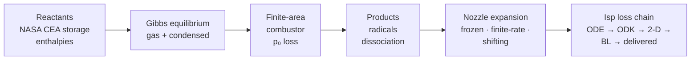

| Stage | What is computed | Module |
|---|---|---|
| Equilibrium | Gibbs minimisation (RP-1311 §2–§3) over 36 gas species (10 from NASA/TP-2002-211556, 26 from the pinned CEA `thermo.inp`); frozen and equilibrium cₚ, γₛ and sound speed; infinite-area rocket performance with a maximum-mass-flux throat | `thermochemistry.equilibrium`, `rocket_equilibrium` |
| Condensed products | Graphite, ice and water, liquid and α-alumina enter and leave the phase set by the RP-1311 §3 test; two-phase alumina at the right area ratios for Al/AP | `thermochemistry.condensed_equilibrium` |
| Finite-area combustor | Stagnation-pressure loss from combustion in a chamber of finite contraction ratio (RP-1311 ch. 6), set by contraction ratio or by mass flux per chamber area | `thermochemistry.finite_area_combustor` |
| Products and radicals | Mole and mass fractions down to 1e-14 at chamber, throat and exit; radical inventory (H, O, OH, …); element and mass-sum residuals; stoichiometric O/F and equivalence ratio | `combustion_efficiency.combustion_product_report` |
| Dissociation energy | Available energy split into sensible and dissociation parts (RP-1311 eq. 4.2), with the recombination heat released by the throat and by the exit | same |
| Efficiency models | Measured c*, C_F and Isp efficiencies (TP-1999-208522); vaporisation-limited c* (NACA TN 4219); Rupe two-streamtube mixing and JANNAF energy-release bookkeeping (ROCCID, CR-187109); SP-8089 injector mixing ratio; L* and stay time (SP-125) | `combustion_efficiency` |
| Finite-rate kinetics | GRI-Mech 3.0 H₂–O₂ subset, analytic Jacobian, RODAS 4(3) stiff integrator, quasi-1-D nozzle march; Bray sudden-freezing estimate | `kinetics`, `kinetics_mechanisms`, `nozzle_kinetics` |
| Loss chain and O/F | ODE → ODK → 2-D → boundary layer → delivered Isp in the TP-1999-208522 order; golden-section O/F optimum for Isp or density impulse | `jannaf_isp_loss_chain`, `optimize_mixture_ratio` |

## Heat transfer

Conduction, convection and radiation are separate modules with their own
verification, and the regenerative-cooling solver couples them:

| Mode | What is computed | Module |
|---|---|---|
| Conduction | Steady multilayer slab, cylinder and sphere walls with k(T) by the Kirchhoff transform, contact resistance and heat generation; lumped capacitance; semi-infinite and one-term/series transient solutions; a finite-volume θ-method transient solver with convective and radiative boundaries and an energy audit; straight and annular fins with exact Bessel functions | `heat_transfer.conduction` |
| Convection | Gnielinski, Dittus–Boelter and Colburn pipe flow, laminar entry (Graetz), Chen, Haaland and Filonenko friction; Taylor's hydrogen correlation for heated supercritical H₂ (TN D-4332); Hess–Kunz; the NASA RTE coolant Nusselt form with curvature factor; SP-125 supercritical film coefficient; flat-plate, Churchill–Bernstein and Churchill–Chu external and natural convection; Rohsenow boiling, peak heat flux, film condensation and a burnout margin screen; Hatch–Papell film cooling | `heat_transfer.convection` |
| Radiation | Planck spectrum and band fractions, thirteen view-factor closed forms (Lienhard Tables 10.2–10.3, Howell catalogue), frustum enclosures, gray N-surface enclosures, radiation-cooled nozzle-extension equilibrium temperature, and H₂O–CO₂ and soot emissivity and absorptivity by WSGG models (Bordbar 2020, Sadeghi 2021) | `heat_transfer.radiation` |
| Regenerative cooling | At every station: Bartz gas-side coefficient at the local wall temperature, conduction through the hot wall, channel fin efficiency, coolant h from Taylor (hydrogen) or Gnielinski, real-fluid coolant properties, an enthalpy march with Chen-friction pressure drop, optional WSGG gas radiation and a material-limit margin | `heat_transfer.regen_chamber` |

The coolant properties come from reference equations of state (Leachman H₂,
Span N₂, Setzmann–Wagner CH₄, Schmidt–Wagner O₂, Ortiz Vega He) and transport
correlations (Lemmon–Jacobsen, Assael, Muzny, Friend–Ely–Ingham, Arp), all in
`thermodynamics.real_fluids`.

## Fluids, flow and aerodynamics

- **Gas dynamics:** isentropic, normal and oblique shock, Prandtl–Meyer, Fanno
  and Rayleigh relations; ideal and off-design C–D nozzles with internal shocks,
  altitude sweeps and a separation screen; conical and Taylor–Maccoll flow.
- **Real fluids:** Helmholtz equations of state for para- and normal hydrogen,
  oxygen, nitrogen, methane and helium within 11 ppm of the NIST WebBook;
  viscosity and thermal conductivity with the critical enhancement; cubic
  fallbacks.
- **Geometry:** conical, Hermite, Rao/thrust-optimised and method-of-
  characteristics contours, exported as CSV, SVG, DXF and STL.
- **Aerodynamics:** thin-airfoil theory and source and vortex panel methods
  with the Kutta condition for NACA sections, lifting-line wings, supersonic shock-expansion with Ackeret and
  Busemann, laminar and turbulent boundary layers with aerodynamic heating,
  ballistic entry with stagnation heating, and launch-vehicle normal force,
  centre of pressure and drag build-up.

## Systems and finite burns

- **Real performance:** loss budgets with covariance bands, Bartz heat flux,
  regenerative coolant balance and two-phase performance bands.
- **Systems:** Tsiolkovsky sizing, multi-stage optimisation, pressure-fed,
  gas-generator and staged-combustion power balances with turbopump models,
  Latin-hypercube and Monte Carlo uncertainty.
- **Finite burns:** constant and profiled burns with explicit propellant-stream
  accounting, pressure-fed blowdown, regulator hysteresis, ullage
  stratification, water hammer, clusters, imported test traces, seeded
  ensembles and hierarchical hot-fire calibration.

## Verification evidence

Every row below is a measurement recorded in the linked document and asserted
by a test. "Declared" is the tolerance written down before the comparison was
made; the measured value is the largest deviation over all reference points.

| Model | Reference | Measured deviation | Declared | Evidence |
|---|---|---:|---:|---|
| Rocket equilibrium (IAC) | NASA CEA 3.3.4, 9 points, LOX/LH₂, LOX/RP-1, LOX/CH₄ | 2e-5 | 1e-2 | [VALIDATION_REPORT](docs/VALIDATION_REPORT.md) |
| Finite-area combustor | CEA 3.3.4, 6 runs incl. RP-1311 examples 9–10 | 1.3e-4 (Mach), 3.9e-6 (Isp) | 2e-3, 1e-3 | [COMBUSTION_EFFICIENCY](docs/COMBUSTION_EFFICIENCY.md) |
| Product mole fractions ≥ 1e-2 | CEA 3.3.4, 7 cases × 3 stations | 4.6e-6 | 2e-3 | same |
| Product mole fractions 1e-10 to 1e-6 | same | 2.5e-4 | 5e-2 | same |
| Condensed-phase rocket, c* and Isp | CEA 3.3.4, LOX/CH₄ with graphite, Al/AP with alumina | 5.1e-6, 4.2e-6 | 3e-5 | [CONDENSED_EQUILIBRIUM](docs/CONDENSED_EQUILIBRIUM.md) |
| O/F optimum | Golden-section searches on CEA 3.3.4 | ≤ 0.03 in O/F, 2e-4 in Isp | — | [COMBUSTION_EFFICIENCY](docs/COMBUSTION_EFFICIENCY.md) |
| Finite-rate nozzle, zero rates | CEA frozen Isp, 8-species set | 2.6e-8 (own frozen), 3e-6 (CEA) | — | [FINITE_RATE_KINETICS](docs/FINITE_RATE_KINETICS.md) |
| Finite-rate nozzle, LOX/LH₂ | Lies between CEA frozen 430.44 s and shifting 451.67 s | 450.64 s | bracket | same |
| Real-fluid viscosity, N₂ O₂ H₂ He | NIST WebBook, 76 rows | 8.8e-10 | — | [REAL_FLUID_TRANSPORT](docs/REAL_FLUID_TRANSPORT.md) |
| Real-fluid conductivity, N₂ O₂ H₂ He, vapour and supercritical | same | 2.2e-5 | — | same |
| Conduction eigenvalues | Lienhard Table 5.2, 41 rows | 6e-6 | printed rounding | [HEAT_CONDUCTION](docs/HEAT_CONDUCTION.md) |
| Transient finite-volume solver | Series solution, 10/20/40 cells | order 1.98–2.01 | order 2 | same |
| Pipe-flow convection | Lienhard Examples 7.2–7.8, 8.1, 9.5 | printed digits | printed digits | [HEAT_CONVECTION](docs/HEAT_CONVECTION.md) |
| Radiation exchange | Lienhard Examples 10.1–10.10 (book σ = 5.67e-8) | 0.22 % | — | [HEAT_RADIATION](docs/HEAT_RADIATION.md) |
| Regenerative cooling, energy balance | Coolant enthalpy rise vs absorbed heat, LOX/CH₄ 7 MPa | 9.3e-10 W on 7.6 MW | 1e-9 of the load | [REGENERATIVE_COOLING](docs/REGENERATIVE_COOLING.md) |
| Regenerative cooling, Bartz | Profile implementation at uniform wall T | < 1e-12 | 1e-12 | same |

The regenerative solver is also checked for physical trends: the counterflow
coolant heats and loses pressure toward the injector, the peak heat flux sits
within 0.15 Mach of the throat, more coolant cools the wall, a poorer conductor
(Inconel 718) heats it, and the heat load converges under station refinement
(41, 81 and 161 stations).

**Cross-validation between models.** `tests/test_cross_validation.py` checks
that independent parts of the library agree where their physics overlap:

- The real-fluid equations of state reduce to the NASA Glenn ideal-gas cₚ at
  low pressure (N₂ and O₂ within 1e-4, H₂ 1.5e-3, CH₄ 2e-3) and to Z = 1 at
  1 Pa.
- Frozen Isp is below shifting Isp, Isp rises with area ratio and entropy is
  constant along the isentrope.
- A narrow finite-area chamber loses more than a wide one, and a wide one
  approaches the infinite-area result within 2e-3.
- The condensed-phase provider equals the gas-only provider when nothing
  condenses (LOX/LH₂).
- Radicals and dissociation fall with chamber pressure (Le Chatelier), and
  radicals recombine along the expansion.
- Random frustum enclosures satisfy summation and reciprocity, and random
  transient walls close their energy balance to 1e-9 (seeded).

## Testing and quality

```bash
python -m unittest discover -s tests      # or: pytest, or .\scripts\test.ps1
python -m ruff check .
node scripts/verify_web_contracts.cjs     # browser chart and render contracts
python scripts/sync_sunumatik_presets.py --check
python scripts/package_smoke_test.py      # build, install in a clean venv, import
```

1980 tests in 142 files; the last full run (2026-10-25, Python 3.12) passed
with 10 skipped. CI runs ruff, the full suite and a package build on Python
3.11 and 3.12. The tests for the newest areas:

| Area | Test file | Tests | Kind of evidence |
|---|---|---:|---|
| Conduction | `test_heat_conduction.py` | 46 | Textbook tables and worked examples, Bessel identities, observed convergence orders, energy audits |
| Convection | `test_heat_convection.py` | 35 | Worked examples to printed digits, correlation overlaps, Taylor exponent read-off |
| Radiation | `test_heat_radiation.py` | 28 | NIST constants, quadrature of Planck's law, worked examples, enclosure identities |
| Regenerative cooling | `test_regen_chamber.py` | 10 | Conservation, resistance network, trends, refinement, hydrogen with Taylor |
| Combustion efficiency | `test_combustion_efficiency.py` | 27 | CEA FAC and composition points, loss-chain identities, O/F optima |
| Finite-rate kinetics | `test_finite_rate_kinetics.py` | 19 | Stiff test set (ROBER, HIRES), limits, monotone rate multipliers, element conservation |
| Condensed equilibrium | `test_condensed_equilibrium.py` | 21 | CEA points, phase rule, phase switching, Gibbs minimum |
| Real-fluid transport | `test_real_fluid_transport.py` | 15 | NIST WebBook rows, the papers' own tables |
| Cross-validation | `test_cross_validation.py` | 11 | Agreement between independent models, seeded property checks |
| Thermal API | `test_api_thermal.py` | 6 | Strict JSON, conservation through the HTTP layer, refused inputs |

Elsewhere the suite has central finite-difference checks of every analytic
partial, event-aware RK4 integrations that reproduce the rocket equation and
analytic cut-off times, Monte Carlo checks of the covariance models, tamper
tests on every persisted document, and gates that keep the code honest:
no registered physical constant may appear as a bare literal, every reference
key in a docstring must resolve in `docs/REFERENCES.md`, and every document
must carry a references section. The web layer is checked for render
contracts, static-file safety, vendored-asset integrity and the launcher's
port and browser behaviour.

## Engineering foundations and references

Public functions and classes document their parameters, units, validity limits
and governing relations in numpydoc docstrings, with a **References** section
whose keys resolve in [docs/REFERENCES.md](docs/REFERENCES.md). Only sources
whose bibliographic record has been verified are cited. The main foundations:

| Area | Primary sources |
|---|---|
| Compressible flow | NACA Report 1135 (Ames Research Staff, 1953); NACA TN 1336 for duct flow with friction and heat addition |
| Nozzles | G. V. R. Rao, *Jet Propulsion* 28(6), 1958; NASA SP-8120 (including the separation rule); NASA method-of-characteristics reports |
| Thermochemistry | NASA/TP-2002-211556 (Glenn coefficients); NASA CEA `thermo.inp` (github.com/nasa/cea, pinned commit); NASA RP-1311 Parts I and II; NASA CEA 3.3.4 (release gate reference) |
| Combustion efficiency | NASA/TP-1999-208522 (loss chain and efficiencies); NASA CR-187109 (ROCCID); NACA TN 4219 (vaporisation); NASA SP-8089 (injector mixing); NASA SP-125 (L*) |
| Chemical kinetics | GRI-Mech 3.0 (Smith et al.); Hairer and Wanner, RODAS and the stiff test set; NASA RP-1328 (LSENS); Bray, 1960 (sudden freezing) |
| Heat transfer | J. H. Lienhard IV and V, *A Heat Transfer Textbook*, 6th ed., v6.00 (2024); NASA SP-125 (Bartz); NASA/TM-1998-206313 (Wadel, RTE method); NASA TN D-4332 (Taylor, hydrogen); Howell's view-factor catalogue; Bordbar, Fraga and Hostikka, 2020 (WSGG) |
| Real fluids | Leachman et al. 2009, Span et al. 2000, Ortiz Vega et al. 2023 (EOS); Lemmon and Jacobsen 2004, Assael et al. 2011, Muzny et al. 2013/2022, Friend, Ely and Ingham 1989, Arp, McCarty and Friend 1998 (transport); NIST Chemistry WebBook |
| Aerodynamics | J. D. Anderson Jr., *Fundamentals of Aerodynamics*, 6th ed., 2017; NACA TR 1048 (Allen and Perkins); NACA TR 572; Barrowman, 1967 |
| Rocket performance | Sutton & Biblarz, *Rocket Propulsion Elements*, 9th ed., 2017; NASA Glenn rocket thrust and specific impulse pages |
| Feed systems and transients | NASA SP-8112; NASA CR-131400, CR-122347, CR-184099; NASA GFSSP |
| Uncertainty | JCGM 100:2008; NIST TN 1297; McKay, Beckman & Conover, *Technometrics* 21(2), 1979; Paule & Mandel, *J. Res. NBS* 87(5), 1982 |
| Constants | BIPM SI Brochure (2019): c, h, k and σ derived from them; U.S. Standard Atmosphere 1976 |

## Validation status and limits

- **Verified, not validated.** Agreement with NASA CEA, the NIST WebBook and
  textbook examples shows that the published models are implemented correctly
  with the published data. It says nothing about how well those models predict
  a real engine; no hardware data is bundled.
- **TRL:** the software evidence and what TRL 5 still needs from hardware tests
  are mapped in [docs/TRL_ASSESSMENT.md](docs/TRL_ASSESSMENT.md). Software
  alone cannot reach TRL 5. Motor and feed evidence and the open gates are in
  [docs/PROPULSION_ASSURANCE.md](docs/PROPULSION_ASSURANCE.md).
- **Heat transfer:** the regenerative solver is quasi-one-dimensional (no axial
  wall conduction, no curvature or entrance enhancement in the default path,
  frozen chamber gas properties) and refuses coolant boiling. Coolant
  correlations used outside their stated range are reported per parameter.
  WSGG gas radiation is fitted at 1 atm and 300–2400 K: it is applied at
  chamber pressure only with a pressure-extrapolation warning, and stations
  hotter than 2400 K get no gas radiation and a critical warning. The
  Hess–Kunz original was not opened; it is used as reported by Taylor and
  NASA CR-678. Transpiration cooling is not implemented.
- **Combustion:** the GRI-Mech 3.0 rate set was optimised for natural gas, not
  rocket chambers, and is used for LOX/LH₂ only; no published ODK/TDK kinetic
  efficiency was available for a direct comparison. Condensed particles have
  no velocity or thermal lag. The Priem–Heidmann vaporisation length (NASA
  TR R-67) is not implemented.
- **Real fluids:** methane viscosity follows the published Friend–Ely–Ingham
  correlation, which differs from the WebBook's unpublished one by up to 4.4 %.
- **Aerodynamics:** Fay–Riddell stagnation heating and radiative entry heating
  are not implemented, because the original sources could not be opened.
- **Not modelled:** CFD, multi-dimensional conduction in ribs, combustion
  instability, particle-resolved two-phase flow, slosh, and nozzle separation
  inside the propagation bridge.
- **Belongs to the consuming framework:** epochs, frames, gravity, burn
  targeting, steering and attitude dynamics.

The detailed fidelity boundary is in [docs/GAP_ANALYSIS.md](docs/GAP_ANALYSIS.md).

| Topic | Documents |
|---|---|
| Start here | [User guide](docs/USER_GUIDE.md) · [API](docs/API.md) · [Architecture](docs/ARCHITECTURE.md) |
| Combustion and thermochemistry | [Combustion efficiency](docs/COMBUSTION_EFFICIENCY.md) · [Finite-rate kinetics](docs/FINITE_RATE_KINETICS.md) · [Condensed equilibrium](docs/CONDENSED_EQUILIBRIUM.md) · [Transport and derivatives](docs/TRANSPORT_AND_DERIVATIVES.md) |
| Heat transfer | [Conduction](docs/HEAT_CONDUCTION.md) · [Convection](docs/HEAT_CONVECTION.md) · [Radiation](docs/HEAT_RADIATION.md) · [Regenerative cooling](docs/REGENERATIVE_COOLING.md) · [Bartz review](docs/BARTZ_REVIEW.md) |
| Fluids and aerodynamics | [Real fluids](docs/REAL_FLUIDS.md) · [Real-fluid transport](docs/REAL_FLUID_TRANSPORT.md) · [Advanced compressible](docs/COMPRESSIBLE_ADVANCED.md) · [Subsonic](docs/AERODYNAMICS_SUBSONIC.md) · [Aerothermodynamics](docs/AEROTHERMODYNAMICS.md) · [Launch vehicle](docs/LAUNCH_VEHICLE_AERODYNAMICS.md) |
| Astrodynamics interface | [Integration guide](docs/ASTRODYNAMICS_INTEGRATION.md) · [Sidera provider](docs/SIDERA_PROPULSION_PROVIDER.md) · [Propagator bridge](docs/PROPAGATOR_PROPULSION_BRIDGE.md) · [Operating surfaces](docs/OPERATING_CONDITION_SURFACES.md) · [Electric propulsion](docs/ELECTRIC_PROPULSION.md) · [Timelines](docs/PROPULSION_TIMELINE.md) |
| Feed systems | [Regulated feed](docs/REGULATED_FEED_DYNAMICS.md) · [Dynamic feed line](docs/DYNAMIC_FEED_LINE.md) · [Distributed feed](docs/DISTRIBUTED_FEED_DYNAMICS.md) · [Blowdown](docs/BLOWDOWN_MODEL.md) |
| Uncertainty | [Propulsion uncertainty](docs/PROPULSION_UNCERTAINTY.md) · [Scenarios](docs/PROPULSION_SCENARIOS.md) · [Hot-fire calibration](docs/HOT_FIRE_CALIBRATION.md) · [Calibration fields](docs/CALIBRATION_FIELDS.md) · [Model discrepancy](docs/MODEL_DISCREPANCY_TRANSFER.md) |
| Evidence and status | [Validation report](docs/VALIDATION_REPORT.md) · [Tolerances](docs/TOLERANCES.md) · [Gap analysis](docs/GAP_ANALYSIS.md) · [TRL assessment](docs/TRL_ASSESSMENT.md) · [References](docs/REFERENCES.md) · [Roadmap](docs/ROADMAP.md) · [Release notes](docs/RELEASE_NOTES.md) |

## How it is built

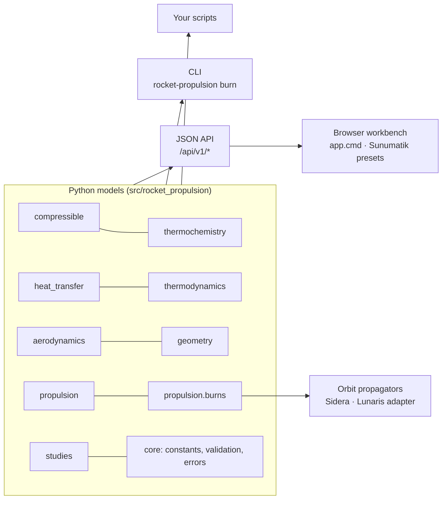

```text
src/rocket_propulsion/
├── aerodynamics/     Airfoils, wings, boundary layers, entry, launch vehicles
├── api/              HTTP transport, JSON API and static-file server
├── compressible/     Isentropic, shock, duct, conical and nozzle flow
├── core/             Constants with sources, strict validation, errors, solvers
├── geometry/         Nozzle contours, method of characteristics, CAD export
├── heat_transfer/    Conduction, convection, radiation, regenerative cooling
├── integrations/     Optional, fail-closed Sidera and Lunaris adapters
├── propulsion/       Performance, losses, cycles, staging, propellants
│   └── burns/        Finite burns and the propagation interface
├── studies/          Workspaces, comparison, sampling, reports, SASS study
├── thermochemistry/  Species data, equilibrium, combustion efficiency, kinetics
├── thermodynamics/   Ideal-gas relations, real fluids, materials, Bartz
└── web/              Browser workbench (app shell, charts, vendored presets)
app.cmd               One-click launcher for Windows
tests/                Unit, reference-data, API, contract and end-to-end tests
examples/             Runnable scripts
docs/                 Model, contract and validation documentation
```

## Conventions

- SI units throughout; angles in the flow and geometry APIs are in degrees.
- Names carry their unit (`thrust_n`, `ambient_pressure_pa`, `time_s`).
- Invalid inputs fail closed with `DomainError` or `InputError`. Nothing is
  silently extrapolated, clamped or approximated; an approximation must be
  requested explicitly (`extrapolate=True`) and carries a warning.
- Every exchange artifact is canonical JSON with a SHA-256 content hash.

## Licence

Copyright © 2026 Ayberk Demirkanat. **All rights reserved.** This software is
proprietary: no licence to use, copy, modify or distribute it is granted
without prior written permission. See [LICENSE](LICENSE). Third-party typefaces
keep their SIL Open Font License; NASA thermodynamic data are United States
Government works.
