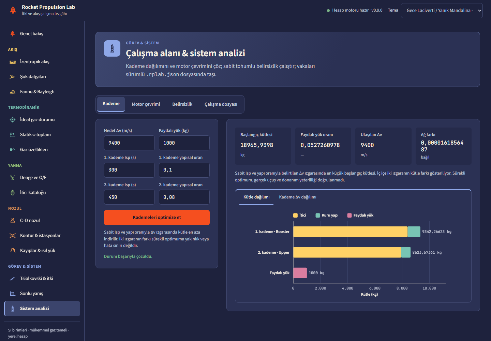
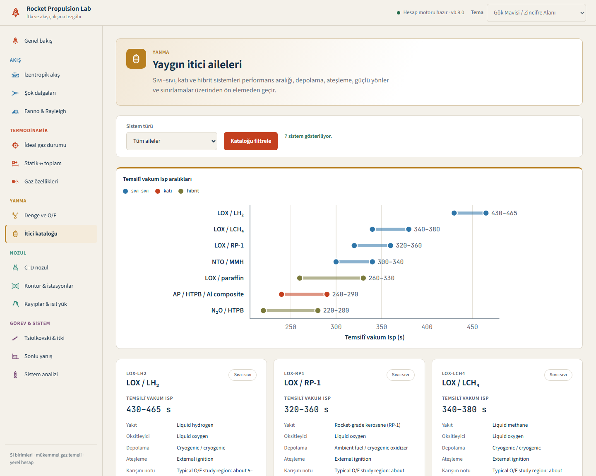
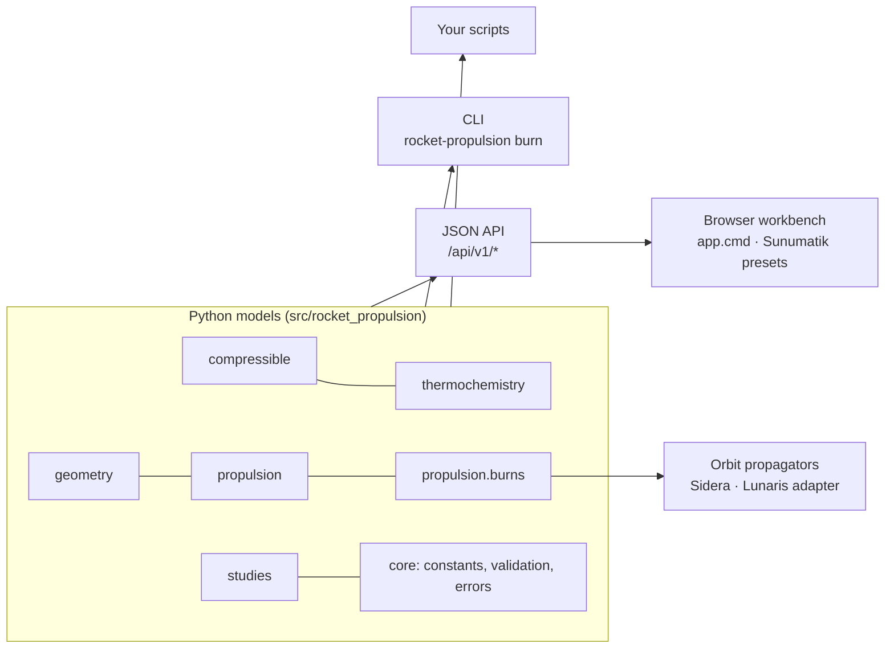

# Rocket Propulsion Lab

**Preliminary rocket-propulsion analysis you can see.** A dependency-free Python
library, a JSON API and a browser workbench for compressible flow,
thermochemistry, nozzle design, engine cycles and finite burns, plus an
event-safe propulsion provider for orbit propagators.

<p align="center">
  
</p>

> Engineering study software, not flight-certified. Python 3.11+, no runtime
> dependencies. Proprietary — all rights reserved (see [Licence](#licence)).

---

## Contents

- [Why it exists](#why-it-exists)
- [Start in one click](#start-in-one-click)
- [A tour of the workbench](#a-tour-of-the-workbench)
- [Use it from Python](#use-it-from-python)
- [Use it from an orbit propagator](#use-it-from-an-orbit-propagator)
- [How it is built](#how-it-is-built)
- [Engineering foundations and references](#engineering-foundations-and-references)
- [Testing and quality](#testing-and-quality)
- [Validation status and limits](#validation-status-and-limits)
- [Conventions](#conventions)
- [Licence](#licence)

## Why it exists

Preliminary propulsion work usually lives in scattered spreadsheets: one for
isentropic tables, one for the nozzle, one for the rocket equation, none of
them traceable. Rocket Propulsion Lab puts the whole early-design chain in one
place, and keeps every number honest:

- **One engine, many front ends.** The same Python models answer the browser
  workbench, the JSON API, the CLI and your own scripts. The browser never
  re-implements an equation; it only displays what the API returns.
- **Traceable by construction.** Every physical constant is registered once
  with its defining source, models cite the reports they implement, and inputs
  fail closed instead of being silently clamped or extrapolated.
- **Ready for trajectory software.** Burns become force and mass-flow models
  with analytic partials and event roots that an orbit propagator,
  orbit-determination filter or optimizer can call at every step. The library
  itself computes no orbits; the companion astrodynamics project is Sidera.

## Start in one click

On Windows, double-click **`app.cmd`** in the repository root. It finds Python
3.11+, starts the local calculation server and opens the workbench in your
default browser. Closing the window stops the server; running it again while
the lab is open only re-opens the browser.

On any platform:

```bash
python -m pip install -e .        # no runtime dependencies
rocket-propulsion --open          # or, without installing: PYTHONPATH=src python -m rocket_propulsion.api.server --open
```

The server listens on <http://127.0.0.1:8765> and moves to 8766–8770 when that
port is busy (`--port` pins one). The same calculations are available as
`POST /api/v1/...` (see [docs/API.md](docs/API.md)) and from the
`rocket-propulsion burn simulate` CLI. Add `?palette=<id>` to the URL to open a
specific colour theme.

## A tour of the workbench

Fourteen calculators sit in five groups, one view at a time. Each group has its
own colour, every result is solved again as soon as you change a field, and
every chart answers the pointer with exact values and marks the state you just
solved.

| Group | Calculators | What you see |
|---|---|---|
| **Flow** | Isentropic flow · normal and oblique shocks · Fanno & Rayleigh | Stagnation and critical ratios with the solved Mach marked on the curves; shock jump ratios across M₁; the θ–β–M diagram with weak and strong branches; sonic-reference lines for friction or heat addition |
| **Thermodynamics** | Ideal-gas state · static ↔ total, process and polytropic path · temperature-dependent species properties | cₚ, γ and h from 200 to 6000 K against the constant-property approximation; P–v and T–s paths |
| **Combustion** | Equilibrium O/F sweep · propellant catalogue | Flame temperature, c*, frozen vs equilibrium Isp with the optimum marked; representative Isp ranges for liquid, solid and hybrid families |
| **Nozzle** | C–D nozzle with off-design and altitude · contour and stations · losses and thermal loads | The flow field coloured by local Mach number; internal shock and separation screen; Rao/MOC/conical contours with CSV/SVG/DXF/STL export; loss budget by term; Bartz heat flux and coolant balance |
| **Mission & system** | Rocket equation and thrust · finite burn · staging, cycle, uncertainty and workspace | Δv against mass ratio; thrust split into momentum and pressure terms; tank inventory and mass/thrust histories; stage mass breakdown; pump vs turbine power; the Δv distribution with P05/P95 |

<table>
  <tr>
    <td width="50%"><br><sub><b>Nozzle</b> — design point and the Mach field of the same area ratio (dark theme).</sub></td>
    <td width="50%"><br><sub><b>Shocks</b> — jump ratios across M₁ with the solved state marked.</sub></td>
  </tr>
  <tr>
    <td><br><sub><b>Combustion</b> — frozen vs equilibrium Isp with the optimum O/F.</sub></td>
    <td><br><sub><b>Finite burn</b> — tank inventory, mass and thrust histories, Sidera export.</sub></td>
  </tr>
  <tr>
    <td><br><sub><b>System studies</b> — staging optimum and stage mass breakdown.</sub></td>
    <td><br><sub><b>Propellants</b> — representative Isp ranges and trade-offs.</sub></td>
  </tr>
</table>

<p align="center">
  
  &nbsp;
  
</p>

The workbench is built on the [Sunumatik](https://github.com/ayberkdt/sunumatik)
preset library: palette tokens (56 light and dark palettes with six data series; the defaults,
cerulean-vermilion and midnight-tangerine, pass the datawiz colour-vision audit), the chart theme with colour-blind
safe series slots and dash patterns, table presets, the focus-layout tab
behaviour, Turkish number formatting, Source Sans 3 / JetBrains Mono and the
duotone propulsion icons. The presets are vendored as rule subsets under
`src/rocket_propulsion/web/vendor/sunumatik`, pinned to a source commit and
SHA-256 hashes in `PROVENANCE.json`
(`python scripts/sync_sunumatik_presets.py --source <checkout>` updates them,
`--check` verifies them).

## Use it from Python

```python
from rocket_propulsion.compressible import calculate_off_design_nozzle

nozzle = calculate_off_design_nozzle(
    chamber_pressure_pa=5.0e6, chamber_temperature_k=3500.0,
    throat_area_m2=0.01, area_ratio=25.0, ambient_pressure_pa=101_325.0,
    gamma=1.22, gas_constant_j_kg_k=355.0,
)
print(nozzle.regime, round(nozzle.thrust_n), "N", round(nozzle.specific_impulse_s), "s")
```

The [`examples/`](examples/) folder has runnable scripts for blowdown,
hot-fire calibration, ensembles, feed systems, electric propulsion, navigation
uncertainty, vehicle geometry and thrust allocation, pulse-mode trim manoeuvres,
and a two-burn timeline with jettison checked against the rocket equation.

What the library covers:

- **Gas dynamics:** isentropic, normal and oblique shock, Prandtl–Meyer, Fanno
  and Rayleigh relations; ideal and off-design C–D nozzles with internal shocks,
  altitude sweeps and a separation screen.
- **Thermochemistry:** NASA Glenn species polynomials, frozen mixtures, an
  external NASA CEA adapter and an experimental local Gibbs equilibrium solver.
- **Geometry:** conical, Hermite, Rao/thrust-optimised and method-of-
  characteristics contours, exported as CSV, SVG, DXF and STL.
- **Real performance:** loss budgets with covariance bands, Bartz heat flux,
  regenerative coolant balance and two-phase performance bands.
- **Systems:** Tsiolkovsky sizing, multi-stage optimisation, pressure-fed,
  gas-generator and staged-combustion power balances, Latin-hypercube and
  Monte Carlo uncertainty.
- **Finite burns:** constant and profiled burns with explicit propellant-stream
  accounting, pressure-fed blowdown, clusters, imported test traces, seeded
  ensembles and hierarchical hot-fire calibration.

## Use it from an orbit propagator

A tabulated burn becomes a force model with one call per integration stage:

```python
from rocket_propulsion.propulsion.burns import (
    AdditionalStateConstraint, PropagatorPropulsionBridge, StreamStateBinding,
    TabulatedBurnArtifact, TabulatedBurnSegment,
)

flows = (("oxidizer", 0.24), ("fuel", 0.06))
artifact = TabulatedBurnArtifact(
    segments=(TabulatedBurnSegment(0.0, 120.0, 1000.0, 1000.0, 1000.0, 1000.0,
                                   0.3, 0.3, flows, flows, "steady"),),
    source_id="engine-acceptance-test-42", source_sha256="0" * 64,
    reference_ids=("NASA-20040000363",),
)
bridge = PropagatorPropulsionBridge(
    artifact,
    stream_bindings=(StreamStateBinding("oxidizer", "m_ox"),
                     StreamStateBinding("fuel", "m_fuel")),
    state_constraints=(AdditionalStateConstraint("m_ox", 2.0),),
    protected_dry_mass_kg=400.0,
    nozzle_exit_area_m2=0.004,
)

# Inside the propagator's right-hand side:
value = bridge.evaluate(
    relative_time_s=30.0, vehicle_mass_kg=520.0, direction=(0.0, 0.0, 1.0),
    additional_states={"m_ox": 60.0, "m_fuel": 18.0},
    ambient_pressure_pa=2_000.0, apply_inventory_limits=False,
)
print(value.acceleration_m_s2, value.mass_derivative_kg_s)
print([event.event_id for event in bridge.event_surfaces()])   # register once
```

The consumer registers the roots, lands on time events, switches the burn off
at inventory roots and maps the analytic partials into its variational
equations. The full protocol is in the
**[astrodynamics integration guide](docs/ASTRODYNAMICS_INTEGRATION.md)**; the
tests run it with an event-aware RK4 loop that reproduces the rocket equation,
analytic cut-off times and mass closure.

| Capability | What a propagator gets |
|---|---|
| **Sidera provider hand-off** | A hash-bound hand-off with absolute-to-relative time mapping, additional-state ordering, event and grid-root inventory, analytic-partial channels and optional body-frame force/moment closure. |
| **Transient burn bridge** | Thrust and vehicle/tank mass derivatives from a hash-verified thrust/flow history, explicit left/right limits at discontinuities, start, stop, dry-mass and reserve roots. |
| **Operating-condition maps** | N-D performance surfaces over pressure, throttle, mixture ratio or power (multilinear or C¹ cubic Hermite) with analytic gradients and no extrapolation. |
| **Feed dynamics** | Regulated pressurant, thermal ullage and feed-line ODEs; dual-feed bipropellant inertance/compliance lines with composed Jacobians. |
| **Mounted gimballed engines** | Two-axis gimbal geometry, force and moment about the instantaneous centre of mass, and analytic derivatives for 6-DOF propagation. |
| **Power-limited electric propulsion** | Hash-verified throttle tables, maximum-thrust or maximum-Isp paths with hysteresis and power-switching roots. |
| **Navigation uncertainty** | Driver priors from hot-fire calibration, the Gates execution-error covariance and Gauss–Markov thrust noise. |
| **Pulse mode, allocation, timelines** | Impulse-bit tables and fewest-pulse plans, bounded least-squares thrust allocation, multi-burn timelines with jettison events. |

## How it is built



```text
src/rocket_propulsion/
├── api/              HTTP transport, JSON API and static-file server
├── compressible/     Isentropic, shock, duct and nozzle flow
├── core/             Constants with sources, strict validation, errors, solvers
├── geometry/         Nozzle contours, method of characteristics, CAD export
├── integrations/     Optional, fail-closed Sidera and Lunaris adapters
├── propulsion/       Performance, losses, cycles, staging, propellants
│   └── burns/        Finite burns and the propagation interface
├── studies/          Workspaces, comparison, sampling, reports, SASS study
├── thermochemistry/  NASA species data, mixtures and equilibrium
├── thermodynamics/   Ideal-gas, polytropic and heat-transfer relations
└── web/              Browser workbench (app shell, charts, vendored presets)
app.cmd               One-click launcher for Windows
tests/                Unit, API, contract and end-to-end tests
examples/             Runnable scripts
docs/                 Model, contract and validation documentation
```

## Engineering foundations and references

Public functions and classes document their parameters, units, validity limits
and governing relations in numpydoc docstrings, with a **References** section
whose keys resolve in [docs/REFERENCES.md](docs/REFERENCES.md). Only sources
whose bibliographic record has been verified are cited. The main foundations:

| Area | Primary sources |
|---|---|
| Compressible flow | NACA Report 1135 (Ames Research Staff, 1953); NACA TN 1336 for duct flow with friction and heat addition |
| Nozzles | G. V. R. Rao, *Jet Propulsion* 28(6), 1958; NASA SP-8120 (including the separation rule); NASA method-of-characteristics reports |
| Thermochemistry | NASA/TP-2002-211556 (Glenn coefficients); NASA RP-1311 Parts I and II (CEA) |
| Heat transfer | NASA SP-125 (Bartz correlation as used in liquid-engine design) |
| Rocket performance | Sutton & Biblarz, *Rocket Propulsion Elements*, 9th ed., 2017; NASA Glenn rocket thrust and specific impulse pages |
| Feed systems and transients | NASA SP-8112; NASA CR-131400, CR-122347, CR-184099; NASA GFSSP |
| Uncertainty | JCGM 100:2008; NIST TN 1297; McKay, Beckman & Conover, *Technometrics* 21(2), 1979; Paule & Mandel, *J. Res. NBS* 87(5), 1982 |
| Constants | BIPM SI Brochure (2019); U.S. Standard Atmosphere 1976 |

## Testing and quality

```bash
python -m unittest discover -s tests      # or: pytest, or .\scripts\test.ps1
python -m ruff check .
node scripts/verify_web_contracts.cjs     # browser chart and render contracts
python scripts/sync_sunumatik_presets.py --check
```

CI runs ruff, the full test suite and a package build on Python 3.11 and 3.12.
The suite includes analytic and reference-data checks, central
finite-difference checks of every analytic partial, event-aware RK4
integrations that reproduce the rocket equation and analytic cut-off times,
Monte Carlo checks of the covariance models, seeded fuzz and property tests,
tamper tests on every persisted document, variational-equation checks against
finite differences of whole propagations, and an automated gate that every
public propulsion-transient type cites its references. The web layer is
checked for render contracts, static-file safety, vendored-asset integrity and
the launcher's port and browser behaviour.

## Validation status and limits

- **Release gate still open:** the nine-point external NASA CEA comparison
  (LOX/LH2, LOX/RP-1, LOX/CH4) is not complete, and the local Gibbs equilibrium
  solver is labelled experimental. See
  [docs/VALIDATION_REPORT.md](docs/VALIDATION_REPORT.md).
- **Hardware readiness is not assessed.** Motor and feed evidence and the open
  TRL5 gates are in [docs/PROPULSION_ASSURANCE.md](docs/PROPULSION_ASSURANCE.md);
  the SASS study outputs are preliminary design screens.
- **No hardware data is bundled.** Performance maps, throttle tables and test
  traces are user-supplied evidence, bound to their source by hash.
- **Not modelled:** finite-rate chemistry, particle-resolved two-phase flow,
  water hammer and acoustic feed modes, slosh, and nozzle separation inside the
  propagation bridge.
- **Belongs to the consuming framework:** epochs, frames, gravity, burn
  targeting, steering and attitude dynamics.

The detailed fidelity boundary is in [docs/GAP_ANALYSIS.md](docs/GAP_ANALYSIS.md).

| Topic | Documents |
|---|---|
| Start here | [User guide](docs/USER_GUIDE.md) · [API](docs/API.md) · [Architecture](docs/ARCHITECTURE.md) |
| Astrodynamics interface | [Integration guide](docs/ASTRODYNAMICS_INTEGRATION.md) · [Sidera provider](docs/SIDERA_PROPULSION_PROVIDER.md) · [Propagator bridge](docs/PROPAGATOR_PROPULSION_BRIDGE.md) · [Operating surfaces](docs/OPERATING_CONDITION_SURFACES.md) · [Electric propulsion](docs/ELECTRIC_PROPULSION.md) · [Timelines](docs/PROPULSION_TIMELINE.md) |
| Feed systems | [Regulated feed](docs/REGULATED_FEED_DYNAMICS.md) · [Dynamic feed line](docs/DYNAMIC_FEED_LINE.md) · [Blowdown](docs/BLOWDOWN_MODEL.md) |
| Uncertainty | [Propulsion uncertainty](docs/PROPULSION_UNCERTAINTY.md) · [Scenarios](docs/PROPULSION_SCENARIOS.md) · [Hot-fire calibration](docs/HOT_FIRE_CALIBRATION.md) · [Model discrepancy](docs/MODEL_DISCREPANCY_TRANSFER.md) |
| Evidence and status | [Validation report](docs/VALIDATION_REPORT.md) · [Tolerances](docs/TOLERANCES.md) · [Gap analysis](docs/GAP_ANALYSIS.md) · [References](docs/REFERENCES.md) · [Roadmap](docs/ROADMAP.md) · [Release notes](docs/RELEASE_NOTES.md) |

## Conventions

- SI units throughout; angles in the flow and geometry APIs are in degrees.
- Names carry their unit (`thrust_n`, `ambient_pressure_pa`, `time_s`).
- Invalid inputs fail closed with `DomainError` or `InputError`. Nothing is
  silently extrapolated, clamped or approximated; an approximation must be
  requested explicitly and carries its evidence.
- Every exchange artifact is canonical JSON with a SHA-256 content hash.

## Licence

Copyright © 2026 Ayberk Demirkanat. **All rights reserved.** This software is
proprietary: no licence to use, copy, modify or distribute it is granted
without prior written permission. See [LICENSE](LICENSE). Third-party typefaces
keep their SIL Open Font License; NASA thermodynamic data are United States
Government works.
