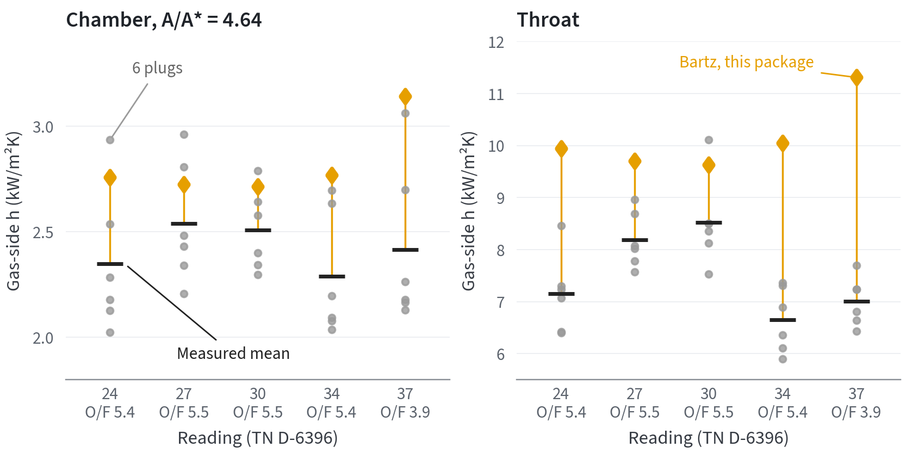

# Regenerative cooling: coupled gas, wall and coolant

`rocket_propulsion.heat_transfer.regen_chamber` solves the thermal state of a
regeneratively cooled thrust chamber station by station. It follows the
marching scheme of NASA's Rocket Thermal Evaluation (RTE) code as documented by
Wadel [WADEL]: the coolant is marched along its flow direction and, at each wall
station, the gas-side film coefficient, conduction through the hot wall and the
coolant-side film coefficient are solved together for the hot-wall
temperature. Each part reuses a module that is verified on its own.

Tests: `tests/test_regen_chamber.py` (10 tests). HTTP route:
`POST /api/v1/regen-chamber`; workbench view: **Nozzle → Rejeneratif soğutma**.

## Public API

```python
from rocket_propulsion.heat_transfer.regen_chamber import (
    Coolant, CoolingChannels, HotGas, bartz_coefficient,
    hot_gas_from_propellant, solve_regen_chamber,
)
```

- `hot_gas_from_propellant(propellant_pair, chamber_pressure_pa,
  oxidizer_fuel_ratio=None, throat_radius_of_curvature_m)` builds the frozen
  chamber state (T₀, c*, cₚ, μ, Pr, γ and the H₂O and CO₂ mole fractions) from
  the CEA-gated equilibrium solver and its transport properties.
- `solve_regen_chamber(contour, gas, channels, coolant, wall_material="grcop-84",
  wall_thermal_conductivity_w_m_k=None, coolant_correlation="auto",
  gas_radiation="none")` returns `RegenChamberResult` with one
  `ThermalStation` per contour station and the totals: heat load, coolant
  outlet temperature and pressure, pressure drop, peak hot-wall temperature,
  material limit and energy-balance residual.
- `bartz_coefficient(gas, throat_radius_m, area_ratio, mach,
  wall_temperature_k)` returns the gas-side coefficient and the recovery
  temperature at one station.

## Equations at a station

1. **Gas side.** Bartz's correlation, SP-125 eqs. 4-13 and 4-14 [BARTZ], with
   the local hot-wall temperature in the σ correction, and the recovery
   temperature with recovery factor Pr^(1/3) [HOPPER]. With
   `gas_radiation="wsgg"`, H₂O–CO₂ gas radiation from the WSGG model
   [BORDBAR] is added through the optically thin mean beam length L₀ = D of an
   infinite cylinder (Lienhard Table 10.4).
2. **Wall.** One-dimensional conduction `q = k (T_wg − T_wc)/t` through the hot
   wall; the lands between channels are straight fins with an adiabatic tip
   [LIENHARD, Ch. 2 and 4].
3. **Coolant side.** Gnielinski with the Chen friction factor, or Taylor's
   hydrogen correlation [TAYLOR] with the coolant-side wall temperature
   `T_wc` in its `(T_w/T_b)` term. `"auto"` picks Taylor for para- and normal
   hydrogen and Gnielinski otherwise. Density, cₚ, μ and k come from the
   reference equations of state and transport correlations in
   `thermodynamics.real_fluids`.
4. **Closure.** The series resistance
   `t/k + s/(h_c (w + 2 η_f h))` per channel pitch `s` is equated with the gas
   heat flux; the hot-wall temperature is found by bisection between the
   coolant and recovery temperatures to 1e-9 relative.
5. **March.** The coolant enthalpy rises by `q dA/ṁ` and its pressure falls by
   the Darcy loss; temperature is recovered from enthalpy by Newton iteration
   on cₚ with a bisection fallback.

## Verification

All checks are in `tests/test_regen_chamber.py`. The reference design is
LOX/CH₄ at 7 MPa, A* = 0.01 m², ε = 10, 100 channels of 1.5 × 3 mm, a 1 mm
GRCop-84 hot wall and methane at 120 K and 15 MPa.

| Check | Result |
|---|---|
| Station Bartz against `calculate_bartz_heat_transfer` at uniform wall T | equal to 1e-12 |
| Coolant enthalpy rise against absorbed heat | residual below 1e-9 of the load |
| Conduction through the wall against the station heat flux | equal to 1e-9 at every station |
| T_wg > T_wc > T_b and T_wg < T_aw | at every station |
| Counterflow coolant temperature and pressure | monotone toward the injector |
| Peak heat flux | within 0.15 Mach of the throat |
| 1.5 × coolant flow; Inconel 718 wall | cooler wall; hotter wall |
| Wall margin | equals the GRCop-84 limit minus the peak wall temperature |
| Heat load at 41, 81, 161 stations | change shrinks; finest step below 2 % |
| LH₂ with parahydrogen at 40 K | Taylor runs hotter than Gnielinski; T_wc/T_b stays below Taylor's 27.6 limit; out-of-range parameters reported once each |
| Impossible inputs | Taylor for methane and channels that do not fit are refused |

For the LOX/CH₄ reference design with 8.6 kg/s of methane the solver gives a
7.37 MW heat load and a 912 K peak hot wall against the 973 K GRCop-84 limit,
with an energy residual of 9.3e-10 W (README example, run on 2026-10-25).

## Hot-fire comparison: NASA TN D-6396

The gas side was compared with measured coefficients from a firing.
Schacht and Quentmeyer (NASA TN D-6396, 1971, Table I) measured the hot-gas
coefficient of NASA Lewis's 12.70 cm throat LOX/GH₂ chamber at about
2.09 MPa, with six copper heat-sink plugs around the circumference in the
cylinder (A/A* = 4.64) and at the throat. `tests/test_hotfire_validation.py`
evaluates `bartz_coefficient` at each station, with the chamber state from
`hot_gas_from_reactants` (GH₂ at 298.15 K, LOX) at the measured O/F and
pressure and the measured mean wall temperature. Measured combustion
efficiency was 0.9885 to 1.00.

| Reading | O/F | Bartz / measured, chamber | Bartz / measured, throat |
|---|---|---|---|
| 24 | 5.39 | 1.18 | 1.39 |
| 27 | 5.50 | 1.07 | 1.19 |
| 30 | 5.49 | 1.08 | 1.13 |
| 34 | 5.41 | 1.21 | 1.51 |
| 37 | 3.90 | 1.30 | 1.61 |
| Mean | | 1.17 | 1.37 |

Recovery temperatures agree with the authors' computed values within 3.3 %.
Bartz over-predicts both stations, the throat most. The authors' companion
report, TN D-2832, found the same thing with its own property basis: a
fitted throat constant of 0.0151 against Bartz's 0.026, while the chamber
constant, 0.0257, matched it. The over-prediction belongs to the
correlation, not to this implementation, and errs toward a hotter predicted
wall. Reading 24's printed O/F (5.934) contradicts its 15.64 % fuel; 5.394 is
used.



*TN D-6396 Table I, five readings at about 2.09 MPa. Grey: the six plugs;
black bar: their mean; orange diamond: `bartz_coefficient`. The two panels
have separate y-axes because the throat coefficient is about three times the
chamber one.*

## Hot-fire heat load: NASA TN D-3532

Pavli et al. (NASA TN D-3532, 1966) fired a 500-lbf LOX/GH₂ engine at
100 psig cooled by liquid hydrogen and tabulated the coolant temperature and
pressure at its inlet and outlet manifolds (Table II). Their engine's helical,
variable-width passages cannot be represented by `CoolingChannels`, so
`tests/test_hotfire_heat_load.py` compares totals instead:

- measured heat load `W_c [h(T_out, p_out) − h(T_in, p_in)]` with the
  parahydrogen equation of state (normal hydrogen gives 13 % less);
- predicted heat load `∫ h_Bartz (T_aw − T_w) dA` over the Fig. 3 wall (20°
  convergence; 15-24.7° changes it by under 1 %), with
  the gas state scaled to the authors' calculated chamber temperature
  (η_c* = 0.962-0.963).

| Firing | Measured (kW) | Bartz, T_w = 1100 K | Bartz, T_w = 1500 K | Ideal gas state, T_w = 1000 K |
|---|---|---|---|---|
| 8 | 252 | 1.28 × | 0.93 × | 1.52 × |
| 9 | 239 | 1.35 × | 0.99 × | 1.60 × |
| 10 | 254 | 1.27 × | 0.93 × | 1.51 × |

The wall temperature, given only as Fig. 15 curves (about 900-1600 K along
the engine), decides the answer: the 1100-1500 K band brackets the measured
load. This is a bracketing check, not an accuracy figure. The authors also
measured a depressed heat flux over the first 3 in., where combustion is
still developing, which Bartz does not model.

## Limits

- Quasi-one-dimensional: no axial conduction in the wall, no circumferential
  variation between land and channel centre, no curvature or entrance
  enhancement and frozen chamber gas properties.
- Coolant boiling is refused (`coolant_boiling`); two-phase flow is not
  modelled. A coolant state outside a transport correlation's range stops the
  march with `DomainError`.
- WSGG gas radiation is a 1 atm fit: it is applied at chamber pressure only
  with a `wsgg_pressure_extrapolated` warning, and stations above 2400 K get
  none (critical warning with the count).
- Two hot-fire comparisons (above): local gas-side coefficients (TN D-6396:
  Bartz 7-30 % high in the chamber, 13-61 % at the throat) and the total heat
  load taken up by the coolant (TN D-3532: bracketed by Bartz for wall
  temperatures of 1100-1500 K). The station-by-station coupled march, with
  its coolant-side correlation and computed wall temperature, has not been
  compared with a firing: no NASA report found tabulates the measured
  coolant-side coefficient per station (TN D-7207 gives only ratios to
  correlations, 0.69-3.92).

## References

- **NASA-TM-1998-206313-WADEL** [WADEL] — M. F. Wadel, NASA/TM-1998-206313, 1998. <https://ntrs.nasa.gov/citations/19980017619>
- **NASA-SP125-BARTZ-PAGES** [BARTZ] — NASA SP-125, printed pp. 100–101, eqs. 4-10, 4-13, 4-14. <https://ntrs.nasa.gov/api/citations/19710019929/downloads/19710019929.pdf>
- **NASA-HOPPER-2012-THERMAL** [HOPPER] — Linne et al., AIAA 2012-0806, printed p. 8. <https://ntrs.nasa.gov/api/citations/20120004103/downloads/20120004103.pdf>
- **NASA-TN-D-4332-TAYLOR-1968** [TAYLOR] — M. F. Taylor, NASA TN D-4332, 1968. <https://ntrs.nasa.gov/citations/19680004771>
- **LIENHARD-AHTT-6.00** [LIENHARD] — J. H. Lienhard V and IV, *A Heat Transfer Textbook*, v6.00, 2024. <https://ahtt.mit.edu/>
- **BORDBAR-FRAGA-HOSTIKKA-2020** [BORDBAR] — H. Bordbar, G. C. Fraga and S. Hostikka, 2020. <https://doi.org/10.1016/j.icheatmasstransfer.2019.104400>

Full records are in [REFERENCES.md](REFERENCES.md).
