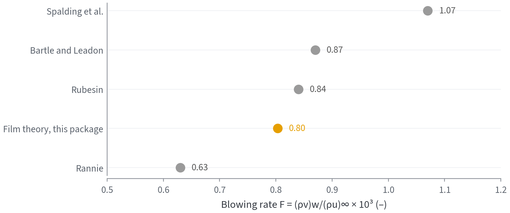

# Transpiration cooling

`rocket_propulsion.heat_transfer.transpiration` models a porous wall that a
coolant is forced through. The coolant takes heat out of the wall on its way
through, and as it leaves the hot face it thickens the boundary layer, which
lowers the gas-side coefficient. Both effects are modelled here, each from
the report it was read in.

Tests: `tests/test_transpiration.py` (19 tests, reference values in
`tests/reference_data/transpiration.json`). HTTP route:
`POST /api/v1/transpiration-cooling`; workbench: **Nozul → Rejeneratif
soğutma → Transpirasyon**.

## Public API

| Function | What it gives | Source |
|---|---|---|
| `film_theory_correction(phi)` | `h/h* = phi/(e^phi - 1)`, blowing (`phi > 0`) or suction | Mickley et al., NACA TN 3208, Eq. (27) |
| `film_theory_rate_factor(R)` | `phi = ln(1 + R)` from the resistance factor `R = phi/theta` | TN 3208 Eqs. (28)-(30) |
| `transpiration_coolant_flux(...)` | coolant mass flux holding the wall at a target temperature, with wall efficiency and radiation | TN 3208, PWA NASA CR-107268 Eq. (III-9), NACA Report 1182 Eq. (20) |
| `transpiration_wall_temperature(...)` | wall temperature for a given coolant flux (inverse of the above) | same |
| `eckert_livingood_temperature_ratio(...)` | turbulent flat-plate `(T_w - T_a)/(T_g - T_a)`, Rannie-Friedman or film theory, with radiation | NACA Report 1182 Eqs. (30)-(31) |
| `rannie_pipe_temperature_ratio(...)`, `rannie_pipe_blowing_rate(...)` | Rannie's porous-pipe relation and its inverse | Kelley & L'Ecuyer, NASA CR-76367, Eq. (2.17) |
| `porous_wall_solution(...)` | solid and coolant temperatures through the wall without local equilibrium, wall efficiency `eta` | PWA NASA CR-107268 Eqs. (III-11)-(III-29) |

## The wall energy balance

With `h*` the gas-side coefficient without blowing (from Bartz, for
example), `T_aw` the recovery temperature, `T_c` the coolant supply
temperature and `eta` the fraction of `T_w - T_c` the coolant picks up inside
the wall:

```
(rho v)_w c_p,c eta (T_w - T_c) = h* theta(phi) (T_aw - T_w) + q_rad
phi = (rho v)_w c_p,c / h*,   theta = phi/(e^phi - 1)
```

Without radiation the coolant flux is closed form,
`phi = ln(1 + (T_aw - T_w)/(eta (T_w - T_c)))`, and for `eta = 1`
`(T_w - T_c)/(T_aw - T_c) = e^-phi`, which is Eckert and Livingood's Eq.
(30) with the sublayer factor set to 1. Radiation is added to the wall load
unchanged; film theory does not block it.

## Verification

| Check | Result |
|---|---|
| Mickley Table VII: the authors' own film-theory `h_T = h*_T phi/(e^phi-1)`, six compartments | reproduced within the printed rounding (0.6 %) |
| Mickley Table VII: measured `h` at the two downstream compartments (H-7 D, H-8 E) | 1.25 and 1.27 times film theory; the authors report the porous plate's unblown friction 15-24 % above a smooth plate (pp. 53-54) |
| Kelley Appendix B, Rannie worked example (F = 0.63e-3, Re = 1e7, Pr = 0.765) | 0.4069 against the printed 0.404; inverse F within 1 % |
| Kelley Table B.1 at 6000 R (Rannie, F = 2.3e-3) | within 3 % |
| Kelley Table B.1 at 3000 R: four published methods give F = 0.63-1.07e-3 | film theory gives 0.80e-3, inside the spread and 4.5 % from Rubesin's boundary-layer solution |
| Eckert & Livingood Eq. (31) without radiation | equals Eq. (30) to 1e-14 |
| Rannie-Friedman against film theory | always the more conservative (hotter wall), as Report 1182 p. 11 states |
| Energy balance of every solved state, with and without radiation | closes to 1e-10 |
| Porous wall: boundary conditions and both differential equations at three depths | satisfied to 1e-7 |



*Kelley & L'Ecuyer's flat-plate case (air into air, M = 0.3,
Re_x = 1e7, T_w = 2000 R): blowing rate each method needs. Grey: the four
methods of their Table B.1; orange: film theory from this module with
Rubesin's St0 = 1.5e-3.*

## Limits

- No foreign-gas diffusion effect beyond the coolant heat capacity in `phi`.
  Rubesin and Pappas (NACA TN 4149) find hydrogen about five times as
  effective as air on a mass basis; film theory with hydrogen's `c_p`
  captures part of that.
- Mickley et al. confirmed film theory for turbulent flow with roughly
  uniform blowing; for other blowing distributions they gave no preferred
  correction.
- Rannie's 1947 report (JPL PR 4-50) was not read; his equation is taken from
  Kelley & L'Ecuyer, who list differences from Duwez-Wheeler data of about
  10 % (mullite) and 30 % (copper) at F = 0.016.
- Not validated against a transpiration-cooled rocket firing.

## References

- **NACA-TN-3208-MICKLEY-1954**: <https://ntrs.nasa.gov/citations/19930084056>
- **NACA-REPORT-1182-ECKERT-LIVINGOOD-1954**: <https://ntrs.nasa.gov/citations/19930092205>
- **NASA-CR-76367-KELLEY-LECUYER-1966**: <https://ntrs.nasa.gov/citations/19660021566>
- **NASA-CR-107268-PWA-1969**: <https://ntrs.nasa.gov/citations/19700004126>

Full records are in [REFERENCES.md](REFERENCES.md).
