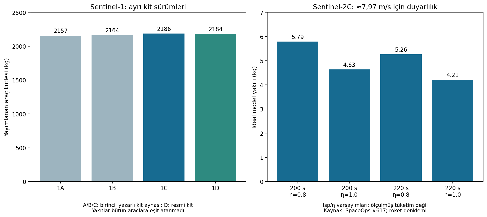

# Sentinel-1 ve Sentinel-2 serileri — karşılaştırmalı SASS raporu (V4)

**Kapsam:** Kullanıcının teyidiyle ilk nesil A/B/C/D araçları karşılaştırılır.
C araçları, dolum bilgisi ve ayrıntılı manevra kayıtlarıyla hesap örnekleridir.
**Kaynak kesiti:** 29 Ekim 2026. Ders: [SASS hazırlığı](../../SASS_PROJECT_PREPARATION.md).

## İki serinin doğrudan karşılaştırması

| Karar / özellik | Sentinel-1 serisi | Sentinel-2 serisi |
|---|---|---|
| Görev / yük | Aktif C-bant SAR, C/D'de AIS | Pasif 13 bantlı MSI |
| Üretici | Thales Alenia Space; SAR Airbus | Airbus; MSI Airbus |
| Görev yörüngesi | ~693 km, LTAN 18:00 | ~786 km, LTDN 10:30 |
| Nominal iki araç tekrarı | 6 gün | 5 gün |
| 2026 nominal ikilisi | C/D; A görevi sona erdi, B pasifleştirildi | B/C; A ek kampanya, D yerde depoda |
| Aile itki tipi | Hidrazin monoprop, blow-down | Hidrazin monoprop, He blow-down |
| Yedekli mimari mirası | 2 dal × 7 adet 1 N; yönelim/yörünge görevleri farklı | 2 soğuk yedekli dal × 4 eğik 1 N |
| C için yayımlanmış kütle/yakıt | 2186 / 154 kg | 1143 / 133 kg |
| Tek net 1 N başlangıç ivmesi, C [H] | 0,4575 mm/s² | 0,8749 mm/s² |
| İtki/operasyon kısıtına örnek | B: plume, tork/teker, Stop Burn FDIR, öngörülemeyen impuls | A/C: tandem ayrımı, eş CAM ve touch-up; cant/duty kaybı |
| EOL kanıtının niteliği | B: gerçekleşen ~580×610 km, ~70 kg kalan; C/D planı açık | 2014 aile planı 786→653 km, 73 m/s, 47 kg; C güncel tahsisi açık |
| Tasarımımıza aktarım | Yakıt rezervi kadar emniyetli manevra kabiliyeti de belirleyici | Tank basıncı ≠ giriş basıncı; net kuvvet ≠ skaler debi toplamı |

Kaynak/sürüm ve matematik sınırları aşağıdaki raporlarda açıklanır. Aile mimarisi
her tekil C/D uçuş konfigürasyonunun kabul kaydı yerine geçmez.

| Dosya | İçerik |
|---|---|
| [Sentinel-1 serisi](SENTINEL-1_SERISI.md) | A/B/C/D, görev/fırlatıcı, bütçeler, CONOPS, 1B gerçek bertarafı, C hesapları |
| [Sentinel-2 serisi](SENTINEL-2_SERISI.md) | A/B/C/D, tandem/CAM kayıtları, motor-besleme mimarisi ve hesaplar |
| [Hesap türetimleri](HESAPLAR.md) | Tsiolkovsky, kütle defteri, cant/debi/süre, yörünge, rezerv, blow-down, güç/link/veri/ısıl |
| [27 maddelik kontrol listesi](KONTROL_LISTESI.md) | Her görev için kapsam ve açık veri durumu |
| [Kaynak dizini](KAYNAKLAR.md) | Birincil kaynaklar, belge sürümleri, ayna/erişim ve fotoğraf kredileri |
| [Girdiler](SERI_VERILERI.json) / [sonuçlar](SERI_SONUCLARI.json) | Araç ve birim etiketli tekrar üretilebilir veri |
| [Sentinel-1C](SENTINEL-1C.md) / [Sentinel-2C](SENTINEL-2C.md) | Önceki ayrıntılı C dosyaları; V4 düzeltmeleri uygulandı |

İki seri raporu gerçek ESA fotoğrafları ve kendi işlevsel şemalarımızı içerir.
Geniş karşılaştırma grafiği:



Kaynaklı uçuş değeri, eski tasarım sürümü, katalog mirası ve varsayım ayrı tutulur.
Eksik as-built güç/kütle/pointing/link/termal bütçeleri tamamlanmış gibi sunulmaz.
Özellikle 4,21 kg ideal S2C yakıt hesabı ölçüm; 154 kg C dolumu bütün S1 serisinin yükü;
S1B'nin eski 530 km hedefi gerçekleşen son yörünge olarak kullanılmaz.

## Hesap ve doğrulama

Depo kökünde Python 3.11+ ile:

```powershell
python scripts/sentinel_series_budget.py --output docs/missions/sentinel/SERI_SONUCLARI.json
python -m unittest discover -s tests -p test_sentinel_series_budget.py
```

25 test yöntemi ve 16 alt test; bağımsız yüksek hassasiyetli denklemler, fiziksel
korunum, olay muhasebesi, kaynakta yayımlanmış drift örnekleri ve bağımlılıksız CLI
tekrarını kapsar. Bunlar **sayısal kontrollerdir**; donanım/ilgili ortam doğrulaması
veya yeni sistem için TRL belgesi değildir. Grafik üretimi ayrıca matplotlib gerektirir;
hesapların çalışma bağımlılığı yoktur.

## Teslim paketi

Git deposunda rapor, hesap, test, fotoğraf ve grafikler bulunur. İndirilen kaynakların
tam PDF/HTML kopyaları ayrı çevrimdışı araştırma paketinde saklanır; dosya bazında URL,
erişim zamanı ve SHA-256 tutulur. Kaynakların mevcut olması yeniden dağıtım lisansı
vermez; fotoğraflarda kredi ve kaynak sayfasının kullanım koşulları korunur.
Operasyon durumu değişebildiğinden raporun kesit tarihi teslimde göz önünde tutulmalıdır.
