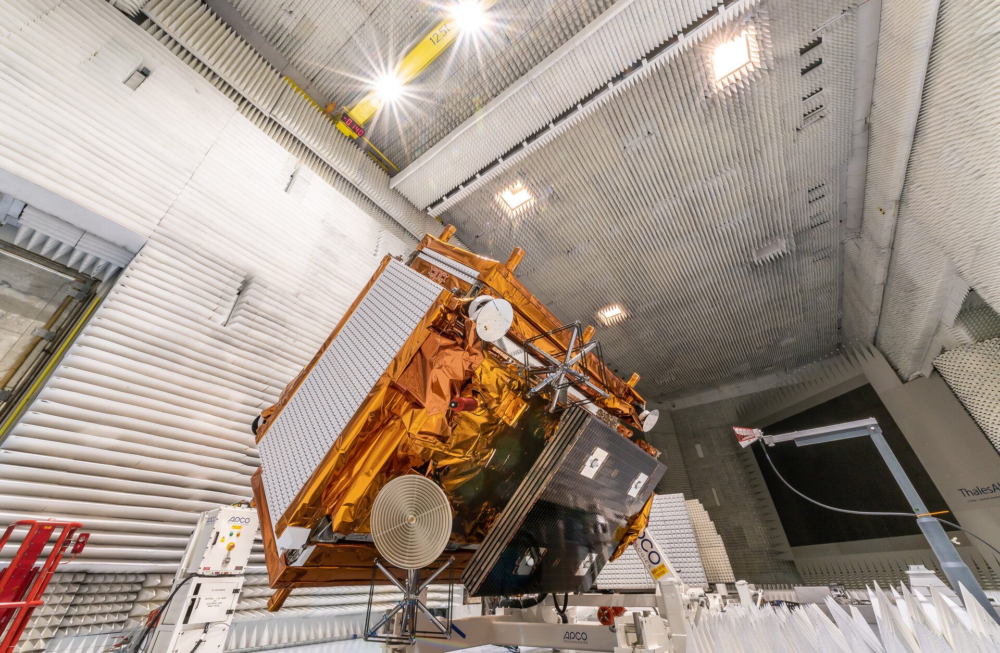
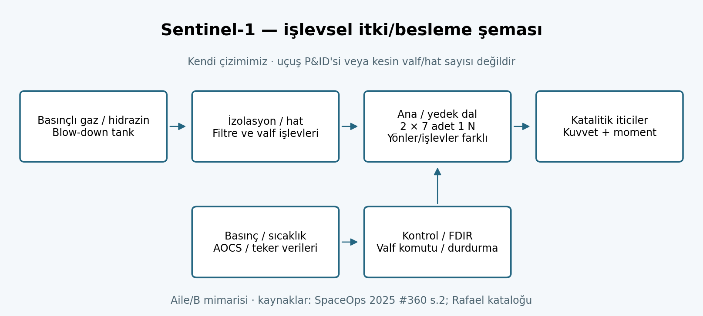

# Sentinel-1 serisi — A/B/C/D karşılaştırmalı itki incelemesi

**SASS / UZM 508E · Revizyon V4 · Kaynak kesiti: 29 Ekim 2026.**
Ana kapsam ilk nesil Sentinel-1A/B/C/D'dir; gelecekteki Sentinel-1 Next Generation bu dört
aracın bir varyantı sayılmaz. Ayrıntılı C örneği: [Sentinel-1C](SENTINEL-1C.md).
Seriler arası hesaplar: [HESAPLAR.md](HESAPLAR.md). Kaynak kodları ve erişim sınırları:
[KAYNAKLAR.md](KAYNAKLAR.md).

**K:** doğrudan yayımlanan değer; **M:** aile/tasarım/katalog mirası; **H:** bu çalışmanın
türetimi; **V:** varsayım; **A:** açık veri ihtiyacı. Katalogdaki sınır, uçuş telemetrisi
değildir. Örneğin 154 kg, 1C'nin yüklenen hidrazinidir; otomatik olarak A/B/D yükü sayılmaz.

## A. Genel görev ve seri farkları

### A1. Amaç, sahiplik, işletme ve üretim

Sentinel-1, Avrupa Birliği Copernicus programının C-bant SAR görev ailesidir. Buluttan ve
Güneş aydınlatmasından büyük ölçüde bağımsız radar görüntüsü; deniz buzu, gemiler, petrol
sızıntısı, taşkın, arazi hareketi ve interferometri uygulamalarına hizmet eder. Programın
sahibi/müşterisi Avrupa Birliği, uzay kesiminin geliştirme ve uçuş işletme sorumlusu ESA,
uçuş kontrol merkezi ESOC'tur. Ana yüklenici Thales Alenia Space; SAR yüklenicisi Airbus
Defence and Space'tir. PRIMA platform mirası vardır. [S1-ESA, S1-SP1322]

Tek aracın 12 günlük, 175 turluk yer izi deseni; yaklaşık 180° ayrılmış iki araçla 6 günlük
nominal tekrar sağlar. Bu, her hedefin her altı günde bulutsuz optik görüntüsü veya sürekli
görüntüsü anlamına gelmez; gözlem modu, enlem ve algılama planı da etkilidir. [S1-WIKI]

### A2. Görevin gerçek fotoğrafı

**Fotoğraftaki araç C'dir.** Kaynak: [ESA, Sentinel-1C undergoing tests](https://www.esa.int/ESA_Multimedia/Images/2023/01/Sentinel-1C_undergoing_tests).
Kredi: **Thales Alenia Space/ImagIN**. ESA Standard Licence; ek kullanım izni gerekebilir.
Bu bir uçuşta çekilmiş fotoğraf veya A/B/D fotoğrafı değildir.

### A3. Araç karşılaştırma tablosu

| Özellik | Sentinel-1A | Sentinel-1B | Sentinel-1C | Sentinel-1D |
|---|---|---|---|---|
| Gerçek fırlatma tarihi, UTC günü | 3 Nisan 2014 | 25 Nisan 2016 | 5 Aralık 2024 | 4 Kasım 2025 |
| Fırlatıcı / uçuş | Soyuz / VS07 | Soyuz / VS14 | Vega-C / VV25 | Ariane 6 / VA265 |
| Araç kütlesi, kit [K] | 2157 kg | 2164 kg | 2186 kg | 2184 kg |
| Kütle kaynağının niteliği | Arianespace yazarlı ayna, PDF s.2–3 | Arianespace yazarlı ayna, basılı s.7 | Arianespace yazarlı ayna, s.3 | Resmî Arianespace, s.3 |
| Bu incelemede doğrulanan yüklenen yakıt | A — aracın dolum kaydı yok | A — bu tabloda atanmadı | **154 kg N₂H₄**, ESA dolum haberi | A — 1C'den kopyalanmadı |
| SAR'ye ek AIS | Yok | Yok | Var | Var |
| Batarya aile/sürüm değeri [M] | 324 Ah | 324 Ah | 360 Ah | 360 Ah |
| Sonuç / 29.10.2026 kesiti | Operasyonel görev 29.06.2026'da bitti | Radar kaybı 23.12.2021; görev sonu 2022; pasifleştirildi | Operasyonel | 01.05.2026'da operasyonel kabul; güncel veri olayı var |

Kaynaklar: [S1-ESA, S1A-VS07, S1B-VS14, S1-VV25, S1D-VA265, S1-FUEL, S1-WIKI,
S1A-END, S1B-DISPOSAL, S1D-LIVE, S1-DASH]. Kit kütleleri, tartım tutanağı yerine
yayımlanmış fırlatma değerleridir. Bazı ikincil kataloglardaki 2300 kg, eski tasarım
bütçesidir; A/B'nin yukarıdaki kit kütlelerinin yerine geçirilmez.

| Aile fiziksel bilgisi [M] | Değer ve kullanım sınırı |
|---|---|
| Operasyon yörüngesi | Yaklaşık 693 km SSO, 98,18°, LTAN 18:00 |
| Açık zarf | Yaklaşık 21 × 2,5 × 4 m; iki 10 m güneş kanadı |
| SAR anteni | 12,3 × 0,821 m; 5,405 GHz; cihaz tasarım kütlesi 945 kg |
| SAR modları | SM, IW, EW, WV; şerit ve çözünürlük farklı, tek bir piksel boyu seriyi temsil etmez |
| Güç | 5900 W ortalama EOL dizi gücü, 2012 aile tasarımı; 1A kiti 6140 W BOL, 1B kiti 5984 W EOL |
| Tasarım ömrü | A kiti 7,25; B kiti 7; C kiti 7,25 ve 10 yıla uzatma ifadesi; D kiti 7,5 yıl; 2012 aile tasarımında 12 yıllık sarf |

Ömür tanımlarındaki devreye alma ve uzatma farkları korunur. Bunları tek bir "tam olarak
7 yıl" hücresine indirmek yanıltıcıdır. [S1-SP1322, S1-WIKI ve ilgili kitler]

### A4. Fırlatma, rampa, enjeksiyon ve tüm görev zinciri

| Araç | Yer / enjeksiyon hedefi | Uydudan önce çalışan itki zinciri |
|---|---|---|
| 1A | CSG, Sinnamary ELS; kit yaklaşık 693 km / 98,18° | Soyuz alt kademeleri → yeniden ateşlenebilir Fregat → adaptör → uydu |
| 1B | CSG, Soyuz ELS; kit yaklaşık 686 km; gerçek yörünge edinimi ISSFD 2017'de incelenir | Soyuz/Fregat; aynı uçuşta diğer yükler de var, toplam yük kütlesi uydu kütlesi değildir |
| 1C | CSG Kourou; kit yaklaşık 700 km / 98,19° | P120C → Zefiro-40 → Zefiro-9 → AVUM+ → Vampire adaptör → uydu |
| 1D | CSG ZL4; kit yaklaşık 693 km SSO | P120C yardımcı katıları + Vulcain 2.1 ana kademe → Vinci kriyojenik üst kademe → uydu |

Kit yörüngeleri **hedef** değerlerdir; epoch ve kovaryans içeren gerçek enjeksiyon
vektörleri değildir. 1B'nin 686 km kit hedefi ile yaklaşık 693 km görev yörüngesi
aynı şey değildir. 1A kitinde anlatılan balistik bekleme ve ayrılma süresi arasında iç
tutarsızlık olduğundan bu metinden kesin üst kademe yakıt akışı çıkarılmaz.

1C için gerçek kalkış resmî sonuç haberinde 21:20 UTC; kitte **planlanan** saniye
21:20:33'tür. Gerçek ayrılma yaklaşık 23:04 UTC'dir; daha fazla hassasiyet ima edilmez.
1D kitindeki 21:02 UTC ve T+33:51 ayrılma, nominal plandır. Vinci'nin ikinci ateşlemesi
üst kademe bertarafı için tasarlanmıştır; bu uydu manevrası değildir. [S1-LAUNCH,
S1-ARI-RESULT, S1D-VA265]

### A5. Güncel durum ve genel tartışma

1B'nin elektrik arızası ile görev sonu, hidrazin tükenmesi değildir. ESA'nın 2024 haberindeki
pasivasyon ve yaklaşık 24 yıllık yeniden giriş öngörüsü, yeniden girişin gerçekleştiği
anlamına gelmez. 1A'nın 2026 bilimsel işletme sonu da bertarafın tamamlandığını kanıtlamaz.
1C/1D nominal ikilisi Haziran 2026'da 6 günlük yapılandırmaya geçti.

**Dinamik durum:** 26–27 Ekim 2026 1D olayı çözüldü; 29 Ekim'de açılan operasyon panosu,
28 Ekim tarihli yeni bir 1D veri olayını ayrıca gösteriyordu. Statik indirilen HTML ayrıntılı
telemetri içermez; olayın bitişi ve kesin arıza nedeni bu incelemede doğrulanmadı.
"Operasyonel kabul" ile "bütün verileri şu an eksiksiz üretiyor" ayrı ifadelerdir. [S1-DASH]

## B. Bütçeler ve alt sistem bağlantıları

### B1. Kütle bütçesi

1C'de 2186 − 154 = **2032 kg** [H]. Bu fark; tank, gaz, yapı, faydalı yük ve diğer
alt sistemleri içerir; sertifikalı kuru kütle değildir. 945 kg aile SAR tasarım kütlesini
bu farktan çıkarmak, C'nin kabul edilmiş platform bütçesini vermez. Her kalemin sürümü
uyuşmadığı için tam alt sistem kapanışı gösterilemez.

Rafael PEPT-590GB tankı katalogda 17,5 kg'dır. On dört 1 N itici için birim üst sınır
0,310 kg kullanılırsa itici alt kümesi en fazla **4,34 kg** olur; tank + bu alt küme
21,84 kg hesabı **modülün toplam kuru kütlesi değildir**. Valf, boru, bağlantı, filtre,
ısıl donanım ve montaj eksiktir; uçuş birimleriyle katalog kütlesinin eşleşmesi de gerekir.
[S1-RAFAEL, basılı s.41,46]

### B2. Güç bütçesi

SAR'nin IW modunda yayımlanan DC tüketimi 3870 W, RF tepe gücü 4368 W'tır; RF tepe ve
DC ortalamayı birbirinden çıkararak termal kayıp veya batarya gereksinimi bulunamaz.
Yörünge ortalaması için mod süreleri, verim, tutulma ve şarj yükleri gerekir. [S1-SP1322]

Rafael birim katalog valfi 28 V'ta 9,2 W; çift ısıtıcıda her eleman 257 Ω:
`P = 28² / 257 = 3,05 W/eleman` [H]. Üç valf eşzamanlı ve her iticide tek eleman açık
**varsayılırsa** itici alt kümesi 36,75 W olur. Bu bir toplam EPS bütçesi değil,
anahtarlama durumu örneğidir; yedek dalın sürekli açık olduğu varsayılmaz.
Ah, tek başına Wh değildir; batarya gerilimi ve deşarj sınırı olmadan enerji bulunamaz.

### B3. Yönelim ve yörünge kontrol bütçesi

AOCS; yıldız izleyici, jiroskop, GNSS, reaksiyon tekeri, manyetik tork ve kimyasal itkiyi
birleştirir. İnterferometri için dar yer izi tüpü kritik; ISSFD 2012'deki yaklaşık
**60 m yer izi kontrol bandı**, SAR piksel boyu veya yönelim bilgisi hatası değildir.
Tam pointing bütçesi için sensör bilgisi, kontrol hatası, yapısal hizalama, anten
boresight ve termal sapma kovaryansları gerekir; kamuya açık C/D bütçesi bulunamadı.

İtici dengesizliğinin momenti `τ = Σ(r_i × F_i)` teker momentumunu artırır. Yakıt
hesabının yanında teker hız ve yönelim eşiklerinin izlenmesi, 1B'nin Stop Burn FDIR
geliştirmesinde doğrudan uçuş deneyimiyle gösterilmiştir. [S1-SPACEOPS360 s.3–6]

### B4. Haberleşme linki bütçesi

Aile tasarımında X-bant yük aktarımı iki 260 Mbit/s kanal ile, ayrıca optik röle terminali
ile yapılabilir. Bunların hepsinin sürekli ve eşzamanlı kullanılabildiği varsayılmaz.
`C/N0 = EIRP + G/T − Lfs − Ldiğer + 228,6` ve kanal başına
`Eb/N0 = C/N0 − 10log10(Rb)` gerekir. EIRP, istasyon G/T, eğiklik, kodlama eşiği ve
uygulama kaybı olmadan gerçek link marjı kapanmaz. Toplam 520 Mbit/s'yi tek taşıyıcının
Eb/N0 denklemine yanlış koymamak gerekir. Sayısal varsayım örneği [hesap notunda](HESAPLAR.md).

### B5. Veri bütçesi

2012 belleği 1410 Gbit = **176,25 GB** [M/H]. İki 260 Mbit/s kanalın 600 s ideal
eşzamanlı indirmesi **39 GB** [H]; kodlama/çerçeveleme, bağlantı kurulumu ve veri
uygunluğu bu üst sınırı düşürür. Bütçe denklemi
`B_son = B_ilk + D_üretim − D_net_indirme`; `0 ≤ B(t) ≤ B_kapasite` bütün zamanlarda
sağlanmalıdır. Günlük toplamın yetmesi, en kötü ardışık geçiş kaybında taşmayı önlemez.

### B6. Isıl bütçe

Tank/hat sıcaklığı, katalizör ön ısıtması, valf ve plume ile panel ısınması birlikte ele
alınır. Rafael tank katalog çalışma aralığı 4…50 °C, itici 5…90 °C'dir [M]; uçuş
setpoint'i veya bütün itki modülünün ortak kalifikasyon aralığı sayılmaz.
`Q_güneş + Q_albedo + Q_DünyaIR + Q_iç + Q_ısıtıcı = Q_radyasyon + dU/dt`.
Yüzey özellikleri ve view factor olmadan radyatör alanı kapatılamaz. β=0 geometrik
tutulma üst örneği 35,30 dk iken şafak–alacakaranlık görev yörüngesinde gerçek tutulma
geometrisi farklıdır; bu değeri gerçek S1 enerji profili gibi kullanmamak gerekir.

### B7. ΔV bütçesi ve B8. Diğer alt sistemler

SAR'nin yanında AIS (yalnız C/D), OBC/aviyonik, güç dağıtımı, kütle belleği, RF/optik
haberleşme, yapı, açılım mekanizmaları ve termal kontrol vardır. Hiçbiri propulsion'dan
bağımsız değildir: manevra sırasında pointing değişimi görüntülemeyi, ısıtıcı gereği güç
planını, burn-off nedeniyle ertelenen CAM ise uçuş emniyetini etkiler.

ΔV; edinim, sürüklenme, eğim/yerel saat, CAM, yeniden yapılandırma ve bertaraf olarak
ayrılmalıdır. C/D'nin yayımlanmış tam tahsis tablosu bulunamadı. Aşağıdaki CONOPS bu
boşluğu saklamaz; geçmiş A/B manevraları C/D'ye ölçülmüş yıllık tüketim olarak atanmaz.

## C. CONOPS ve ona bağlı ΔV çıkarımı

| Evre | İşlem / kanıt | ΔV ve hesap durumu |
|---|---|---|
| Yer hazırlığı | Sızdırmazlık, elektrik testleri, kontrollü yakıt/gaz dolumu | Uydu orbital ΔV'si yok |
| Fırlatma → ayrılma | Fırlatıcı, üst kademe, adaptör | Uydu yakıt defterine yazılmaz |
| LEOP | Güç/açılım, ilk yönelim, GNSS ve itki kontrolü | Gerçek enjeksiyon elemanları gerekir |
| Yörünge/faz edinimi | Yer izi, dışmerkezlik, eğim, takımyıldız yuvası | S1B ISSFD 2017 planlama dağılımları var; C/D toplamı açık |
| Rutin | SAR planı, periyodik düzlem içi/dışı düzeltme, momentum yönetimi | Drag; alan/kütle, yoğunluk ve güneş aktivitesiyle değişir |
| CAM / güvenli mod | Risk olayı, yanma, geri dönüş ve yeniden kazanım | Olayın iki zıt ateşlemesinin maliyeti toplanır |
| Devir/yeniden fazlama | A/B → C/D sürekliliği | Haziran 2026 C/D manevraları; ayrıntılı impuls listesi açık |
| Bertaraf/pasivasyon | Yeni bilim verisi sonu; erişilebilir yakıt ve donanımla yörünge alçaltma | Ulaşılmış yörünge hedef plandan ayrılmalı |

Örnek C senaryosunda [V] edinim 11,01 m/s (B planlama kalemlerinin aritmetik toplamı;
birleşik 1σ olasılık bütçesi **değil**), rutin 1 m/s/yıl × 7,25 yıl, CAM 3 m/s seçilsin.
693→580×610 km ideal iki impuls 52,58 m/s civarında olduğundan toplam yaklaşık
**73,84 m/s** olur. 205 s ve eksensel verim 1 kabulünde yaklaşık **78,84 kg** kullanılır.
Bu, C için onaylanmış bertaraf yörüngesi veya yakıt tahsisi değildir; aşağıdaki gerçek B
deneyimiyle kıyaslanan eğitim senaryosudur. Kesin yeniden üretim [HESAPLAR.md](HESAPLAR.md).

### S1B: plan, uygulama ve son durumun ayrılması

1B ediniminde plume nedeniyle bazı IP ateşlemeler 300 s yerine 35 s ile sınırlandırıldı;
yaklaşık %30 etkili itki kaybı raporlandı. OOP için 600 s ve ardından 6 saat toparlanma
sınırı 2017 makalesinin operasyon koşuludur; bütün seri/ömür için değişmez limit değildir.
[S1-ISSFD]

2023–2024 bertarafında daha önce çoğunlukla yönelim için kullanılan −Z iticileri ve
aracın pitch dönüşüyle yeni yörünge manevraları uygulandı. Birden çok iticinin seçilmesinin
belgeli nedeni **plume sınırlaması ve operasyon süresi**dir; yalnız katalog toplam
impulsundan tarihsel sebep çıkarılmaz. Dengesiz aşınma, teker hızlanması ve güvenli moda
geçiş riski Stop Burn FDIR'nin geliştirilmesine yol açtı. [S1-SPACEOPS360]

SpaceOps #226'nın son durumu: 23 Nisan 2024'te manevraların durması; yaklaşık
**580×610 km**, yaklaşık **70 kg kalan hidrazin**, yaklaşık **24 yıllık** yeniden giriş
öngörüsü. Daha önceki CGMS belgesindeki 530 km hedef ve yaklaşık 88 kg ara tahmin,
gerçekleşen son durum diye sunulmaz. Eylül 2024 elektriksel pasivasyon ayrı evredir; yakıt kaldığı için tam itki sistemi
pasivasyonu sağlanamadı.
[S1-SPACEOPS226 s.20 ve devamı; S1B-DISPOSAL]

## D. İtki sistemi: donanım, hesap ve değerlendirme

### D1. Tip, besleme ve yerleşim

Tek bileşenli hidrazin kimyasal itki; basınçlı tanktan beslenen blow-down mimarisi.
Katalizör yatağındaki ayrışma sıcak gaz üretir; ayrı oksitleyici yoktur. ESA/operasyon
yazarlarının aile tarifinde iki yedekli dalın her birinde **7 adet 1 N** itici vardır:
3 yörünge ve 4 yönelim işlevli itici. Toplam 14 donanım, net eksensel 14 N demek değildir.
Yön, yedek dal seçimi, duty cycle ve plume kısıtları kullanılabilir kuvveti belirler.
[S1-SPACEOPS360 s.2; S1-ISSFD]

Şema bu çalışma tarafından hazırlanmıştır: tank → izolasyon/hat/filtre → ana veya yedek
dal → katalitik iticiler; basınç/sıcaklık ve AOCS → valf komutu/FDIR. Bu bir kabul edilmiş
uçuş P&ID'si değildir. Rafael PEPT-590GB aile tankı Ti-6Al-4V, diyaframlı, yaklaşık
Ø587 × 1170 mm, 204 L, 17,5 kg; nominal 154 kg kapasite ve 4:1 blow-down bilgisi vardır.
Gaz uyumluluğu GN₂/GHe'dir; bu, her araçta hangi gazın yüklendiğini kanıtlamaz.

### D2. Basınç, kuvvet ve kalifikasyon kapsamı

| Katalog niteliği [M] | Değer / ayrım |
|---|---|
| Tank çalışma / proof / burst | 27,4→5,5 / 41,1 / 54,8 bar; sonuncusu nominal burst şartı, 72 bar raporlanan kopma |
| İtici Tip 1 giriş basıncı | 24,5→9 bar abs |
| İtici Tip 2 giriş basıncı | 24,5→5,5 bar abs |
| BOL kuvvet | Tip 1: 1,3–1,4 N; Tip 2: 1,0–1,1 N |
| SSF Isp katalog alt sınırı | >214 s @22 bar; >205 s @5,5 bar; C uçuş haritası değil |
| Toplam impuls / darbe adedi | Tip 1: 100000 N·s / 100000; Tip 2: 60000 N·s / 58000 |
| Valf / filtre / nozul | NC çift bobin/çift seat; 15 µm; alan oranı 130 |

Kaynak: Rafael basılı s.41,46. Tip 1'in 9 bar altına uygunluğu Tip 2'nin 5,5 bar sınırıyla
kanıtlanamaz. Tank 27,4 bar katalog üst sınırı, C'nin ölçülmüş başlangıç tank basıncı
değildir. Her basınç noktası aynı termal/akış koşuluna ait olmadığından katalog
rakamlarından doğrusal uçuş thrust/Isp haritası uydurulmaz.

### D3–D6. ΔV, kütle debisi, süre ve yakıt

`ΔV = g0 Isp ln(mi/mf)`, `ṁ = ΣFi/(g0 Isp)`; eksensel kuvvet
`Feksen = Σ di Fi cosθi`. `ηeksen = Feksen/ΣdiFi` ile etkin eksensel Isp düşer.
İtki kuvveti ideal toplam ΔV'yi doğrudan belirlemez; yanma süresini ve sonlu yanma
kayıplarını belirler. Tam eşitlikler ve kademeli kütle muhasebesi hesap ekindedir.

1C'nin 154 kg'ının tamamı ideal kullanılabilse: Isp 205/214/220 s için sırasıyla
**146,9 / 153,3 / 157,6 m/s** [H/V]. Sonuncusu yalnız duyarlılık noktasıdır; Rafael
uçuş ölçümü değildir. 1 N, 220 s eşleşmiş ideal noktada **0,4635 g/s**; başlangıçta
2186 kg kütleyle 1 m/s için **1,013 kg**, yaklaşık **36,4 dakika** tek eksensel itici
yanması gerekir. Kısa darbe minimum impulsu ve uzun yanma ısıl sınırları ayrı test edilir.

### D7. Rezerv ve koşullu ek ömür

`mrezerv = myüklenen − mharcanan − mEOL − mkullanılamayan − memniyet`.
Ek yıl ancak yıllık tüm tüketimler, belirsizlik, blow-down sonunda erişilebilir basınç,
valf çevrim ve impuls ömrü de biliniyorsa bulunur. Sabit yıllık ΔV ve etkin Isp için
rezerv korunarak roket denklemiyle çözülmelidir; bugünkü gram/yıl ile bütün yakıtı
bölmek fiziksel bir ömür tahmini vermez. 1B'nin 70 kg örneği bu ayrımın uçuş karşılığıdır.

### D8. Anlık / sonlu / sürekli

Sistem aralıklı kimyasal ateşlemelidir. "Anlık" fiziksel bir mod değil, yörünge hesabı
yaklaşımıdır. Örneğin 700 s'lik bertaraf ateşlemesi 98,63 dakikalık turun yaklaşık %11,8'i
olur; bu durumda konum/yön değişimiyle sonlu yanma propagasyonu gerekir. Birkaç saniyelik
bakım ateşlemesi için impuls yaklaşımı daha elverişlidir. Elektrikli sürekli itki değildir.

### D9. Güvenlik ve regülasyon

Toksik hidrazin, basınçlı gaz, sıcak katalizör, sızıntı/kontaminasyon, plume ile donanım
ısınması ve başarısız pasivasyon görev tehlikeleridir. Bu çalışma dolum/ateşleme prosedürü
değil, tehlike ve doğrulama kapsamının akademik değerlendirmesidir. Valf kapalı arıza
varsayımı tek başına çift hata toleransı veya güvenlik kabulü kanıtlamaz.

Eski 25 yıllık bertaraf hedefiyle ESA'nın Kasım 2023'te yürürlüğe giren LEO'dan en fazla
5 yılda temizleme hedefi aynı gereksinim değildir. Politika ESA'nın tedarik/işlettiği
görevleri ve uzatma değerlendirmelerini kapsar; bu araç için geçerli baseline, geçiş
kararı ve değerlendirme olmadan "tam uyumlu" veya "eski olduğu için muaf" denmez.
[DEBRIS-ESA-2023]

### D10. TRL ve tasarımımıza aktarım

İtici ailesinin belgeli uçuş mirası, ilgili uçmuş konfigürasyon için operasyonel başarının
kanıtıdır. Her A/B/C/D bileşeninin uçuş öncesi resmi TRL'si açık değildir; 6→9 geçişi
atanamaz. Bir parçanın mirası, yeni tank/hat/valf/AOCS bütününün TRL'sini belirlemez.
Bizim motor+besleme hedefimiz için temsilî basınç, sıcaklık, duty cycle, gaz erişimi,
off-nominal kapanma, tork ve termal sınırlar birlikte doğrulanmalıdır. Henüz kendi
tasarımımız/görev gereksinimlerimiz seçilmediğinden bu rapor bir gereksinim ve deney
girdisidir; yeni sistemin TRL 5'e ulaştığına dair kanıt değildir.

## Tam kapanış için istenecek veriler

C/D'nin uçuş kabul kütle defteri ve tank/gaz dolum tutanakları; seri numaralı itici tipleri;
hat basınç kayıpları; soğuk/sıcak thrust–Isp haritaları; kullanılabilir yakıt tahmini ve
belirsizliği; güncel CAM/EOL tahsisi; itici başına impuls/çevrim defteri; EPS mod profilleri;
pointing kovaryansı; RF link ve termal model kabul raporları. Kamuya açık kaynaklarda
bulunmayan bu kalemler hesap sonuçlarına ölçüm gibi eklenmemiştir.
