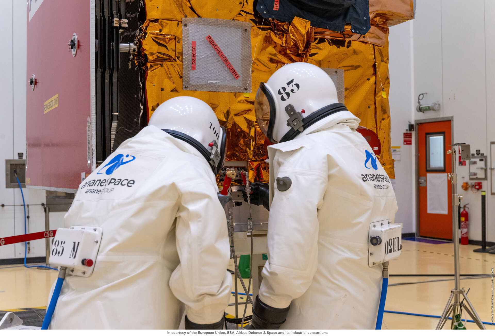

# Sentinel-2C — ayrıntılı C örneği (V4 düzeltmesi)

**Ana kapsam:** [Sentinel-1 serisi](SENTINEL-1_SERISI.md) ve
[Sentinel-2 serisi](SENTINEL-2_SERISI.md). Bu dosya ayrıntılı C örneğidir.
Kaynak kesiti 29 Ekim 2026; doğrulama kapsamı [HESAPLAR.md](HESAPLAR.md).
Kanıt sınıfları [SENTINEL-1C.md](SENTINEL-1C.md) ile aynıdır: **[D]** 2C'ye özgü
birincil kaynak · **[M]** Sentinel-2 ailesi / A-B mirası · **[H]** hesap · **[S]** varsayım ·
**[Y]** bulunamadı. Bağlantılar: [KAYNAKLAR.md](KAYNAKLAR.md).

## A. Genel görev bilgisi

### A1. Amaç, operatör, üretici

- **Amaç [M]:** Copernicus için yüksek çözünürlüklü çok bantlı optik görüntüleme: tarım ve
  bitki örtüsü, orman, kıyı ve iç sular, afet. Pasif sensördür; bulut ve gece görüntüleme
  yapılamaz. [S2-ESA]
- **Yönetim [D/M]:** ESA (geliştirme, işletme, yönetim; uçuş kontrolü ESOC, Darmstadt);
  program Avrupa Komisyonu Copernicus. [S2-ESA], [S2-OPS]
- **Üretici [M]:** Uydu: Airbus Defence and Space Almanya; MSI cihazı: Airbus Defence and
  Space Fransa. [S2-ESA]
- **Faydalı yük [M]:** MSI, 13 bant (443–2190 nm): 4 × 10 m, 6 × 20 m, 3 × 60 m; 290 km
  şerit. Tek uyduyla ekvatorda 10 gün, iki uyduyla 5 gün tekrar. [S2-ESA], [S2-CDSE-DOC]

### A2. Fotoğraf ve fiziksel bilgiler

Fotoğraf kaynağı, kredi ve lisans: [kaynak dizini](KAYNAKLAR.md).
Aynı fotoğraf seri raporunda açık araç kimliğiyle yer alır.

| Kalem | Değer | Kaynak ve kapsam |
|---|---|---|
| Fırlatma kütlesi | **1143 kg** | [D] Resmî VV24 kiti s.3 ("MASS AT LAUNCH 1, 143 kg") |
| Fırlatıcının toplam yükü | 1220 kg | [D] VV24 kiti s.2 (uydu + adaptör/ayırma donanımı) |
| Yüklenen itici | **133 kg hidrazin**, tank **21 bar helyumla** basınçlandırıldı (16 Ağustos 2024); latch valfleri kapatıldı | [D] ESA, 19.08.2024 |
| Aile kütlesi | 1140 kg (123 kg yakıt dahil); tasarım belgesinde 1225 kg (70 kg marj dahil), 117 kg hidrazin | [M] ESA Facts and figures; SP-1322/2 s.25, s.65 |
| Boyut | 3,4 × 1,8 × 2,35 m (katlı) | [M] ESA; SP-1322/2 |
| Güneş dizisi | 7,2 m², 1700 W (ömür sonu); ESA operasyon sayfası: başlangıçta 2300 W | [M] SP-1322/2 s.65; [S2-OPS] |
| Batarya | 87 Ah (ömür sonu) | [M] SP-1322/2 s.65 |
| Operasyon yörüngesi | 786 km, güneş eşzamanlı, 98,62°, LTDN 10:30 | [M] ESA; SentiWiki |
| Enjeksiyon hedefi | ~775 km, 98,57°, LTDN ~10:30 | [D] VV24 kiti s.2 |
| Tasarım ömrü | "7 yıl için tasarlandı, en az 10 yıl çalışması bekleniyor" | [D] VV24 kiti s.3 |
| Aile ömrü | 7,25 yıl (3 ay devreye alma dahil); batarya ve itici 12 yıl için | [M] SentiWiki; Airbus 2014: "ek 5 yıl için sarf malzemesi" |

### A3. Fırlatma ve tüm görev zinciri

| Olay | Bilgi | Kaynak |
|---|---|---|
| Kalkış | **5 Eylül 2024, 01:50 UTC** (Kourou 4 Eylül 22:50), **Vega VV24**, Vega'nın 22. ve son uçuşu; Avrupa Uzay Üssü | [D] Arianespace |
| Erteleme | Kit planı 3 Eylül Kourou (4 Eylül 01:50:27 UTC); elektrik sorunları nedeniyle ertelendi | [D] VV24 kiti s.2; ESA blog 04.09.2024 |
| Fırlatıcı | P80 (katı) → Zefiro-23 (katı) → Zefiro-9 (katı) → AVUM (sıvı, yeniden ateşlenebilir) | [D] VV24 kiti s.4 |
| Planlanan olaylar | P80 ayrılması T+1:56, Z23 T+3:39, kaporta T+3:56, **Z9 T+6:32**, AVUM 1. ateşleme T+7:36, 2. ateşleme T+54:36, ayrılma T+57:33 (plan), AVUM 3. ateşleme T+1 sa 54:52 | [D] Resmî VV24 kiti s.5 |
| Gerçekleşen ayrılma | **T+57 dk 27 s**; ESA: ~04:48 CEST (~02:48 UTC) | [D] Arianespace; ESA |
| İlk sinyal | 05:02 CEST, KSAT Troll (Antarktika); güneş paneli açıldı | [D] ESA, 10.09.2024 |

**V2 düzeltmeleri:** Z9 ayrılması 5:52 değil **6:32**'dir; 57:27 gerçekleşen, 57:33 kit
planıdır. V2'nin kullandığı üçüncü taraf aynası kitin eski bir sürümüdür (toplam yükü yanlış
olarak 1143 kg yazar). ESA blogundaki "4 Eylül 03:50 CEST" tarihi hatalıdır; kullanılmamalı.

**Sistem sınırı:** Yörüngeye çıkış enerjisini Vega sağlar; uydunun 133 kg hidrazini yalnızca
ayrılmadan sonraki manevralar içindir.

### A4. Operasyonel durum (29 Ekim 2026) ve genel değerlendirme

| Tarih | Olay | Kaynak |
|---|---|---|
| 6 ve 9 Eylül 2024 | LEOP 6 Eylül (Cuma) akşamı resmen bitti; devreye alma 9 Eylül (Pazartesi) başladı | [D] ESA, 10.09.2024 (günler makale tarihinden) |
| 31 Ekim – 19 Aralık 2024 | 2A ile tandem uçuş (kalibrasyon) | [D] SpaceOps 2025 #617; CDSE |
| Aralık 2024 sonu | Yörüngede devreye alma tamamlandı | [D] CDSE 08.01.2025 |
| **21 Ocak 2025** | 2C, operasyonel görevi 2A'dan devraldı (planlanan ilk algılama 09:12:45 UTC) | [D] CDSE belgesi (gerçekleşen tarih); CDSE 17.01.2025 (planlanan saat) |
| 8–11 Ağustos 2025 | Uydu sorunu: 8 Ağustos 11:00 – 11 Ağustos 18:00 UTC arasında planlanan çekimlerin %36,25'i kaybedildi | [D] CDSE node/2594 |
| 8–9 Eylül 2025 | MSI dekontaminasyonu (planlı veri kesintisi) | [D] CDSE node/2642 |

- **Durum:** 2C, 2B ile nominal iki uydulu takımyıldızında operasyonel. 2A, 2B'den 36°
  uzakta özel uzatma kampanyasında; kampanya 31 Aralık 2027'ye uzatıldı. **Sentinel-2D
  henüz fırlatılmadı** (WMO OSCAR: planlanan, ≥2028). [S2-WIKI], [S2-EXT], [S2D-OSCAR]
- **Genel değerlendirme:** Geniş şerit (290 km) ve 13 bant, sık tekrar ile birleşince küresel
  kara izlemenin temelini oluşturur. Optik olduğu için bulut ve aydınlatmaya bağımlıdır;
  sıkı geometrik doğruluk (≤20 m jeolokasyon) çok iyi yönelim bilgisi ve ısıl kararlılık
  gerektirir.

## B. Bütçeler

### B1. Kütle bütçesi

| Kalem | kg | Sınıf |
|---|---:|---|
| Fırlatma kütlesi (2C) | 1143 | [D] |
| Hidrazin (2C, yüklenen) | 133 | [D] |
| Fırlatma − hidrazin | 1010 | [H] fark; helyum dahil, doğrulanmış kuru kütle değil |
| Tasarım bütçesindeki sistem marjı | 70 (1225 kg içinde) | [M] SP-1322/2 s.25 |
| MSI | 275 (WMO, 2A) veya 290 (SP-1322/2) | [M] iki kaynak farklı |
| 1 N itici (birim, valflerle) | 0,290 | [M] ArianeGroup veri sayfası |
| Diğer alt sistemler, tank, helyum | — | [Y] |

### B2. Güç bütçesi [M]

| Kalem | Değer | Kaynak |
|---|---|---|
| Güneş dizisi | 1700 W (ömür sonu), 7,2 m², GaAs üçlü eklem | SP-1322/2 s.65 |
| Uydu tüketimi | **1,4 kW (nominal mod)** | SP-1322/2 s.65 |
| Batarya | 87 Ah (ömür sonu) | SP-1322/2 s.65 |
| MSI | 266 W (WMO, 2A) | WMO OSCAR |

1700 W üretim − 1,4 kW nominal tüketim = **~300 W fark** [H]; tutulma, şarj ve kayıplar
bilinmeden kesin marj değildir. 2C'ye özgü mod tablosu [Y].

### B3. Yönelim (pointing) bütçesi [M]

Airbus 2014 tasarım gereksinimleri (Wiedermann vd., s.4):

| Parametre | Gereksinim | Güven |
|---|---:|---|
| Mutlak yönelim hatası | ≤ 1200 µrad / eksen (~0,069°) | %99,7 |
| Mutlak yönelim bilgisi hatası | ≤ 10 µrad / eksen | %95,5 |
| Mutlak açısal hız hatası | ≤ 20 µrad/s / eksen | %99,7 |
| Mutlak yatay konum bilgisi | ≤ 12 m | %99,7 |
| Jeolokasyon (yer kontrol noktası olmadan) | ≤ 20 m | %95,5 |

Donanım: 3 yıldız izleyici (2/3 yedekli), fiber optik jiroskop IMU, 2 çift frekanslı GPS,
4 reaksiyon tekeri (3/4 yedekli), 3 manyetik tork çubuğu. Yıldız izleyiciler ve jiroskop,
doğrudan MSI teleskop yapısına monte edilir. [S2-AOCS], [S2-SP1322] s.16. Farklı güven
düzeylerindeki kalemler doğrudan RSS ile toplanamaz.

### B4. Haberleşme linki bütçesi [M]

- X-bant yük verisi: **560 Mbit/s, 8-PSK**, isoflux anten; S-bant: 64 kbit/s yukarı,
  2 Mbit/s aşağı (Kiruna); Tesat'ın optik terminali (OCP) ile EDRS lazer aktarımı.
  [S2-SP1322] s.18; [S2-OPS]; [S2-ESA]
- EIRP, G/T ve gerekli Eb/N0 yayımlanmadığı için gerçek link marjı hesaplanamaz [Y].

### B5. Veri bütçesi [M]

- 2,4 Tbit (= 300 GB) katı hal kütle belleği; 560 Mbit/s indirme. [S2-SP1322]
- ESA operasyon sayfası hem "tur başına 1,6 TB'a kadar" hem "iki uydudan günde 1,6 TB
  sıkıştırılmış ham veri" der; ikisi çelişir, kesin günlük değer olarak kullanılmadı. [S2-OPS]
- 10 dakikalık geçişte ideal aktarım 42,0 GB [H].

### B6. Isıl bütçe

MSI optik yapısının ve yıldız izleyici hizasının ısıl kararlılığı kritik. Isıl alt sistem;
radyatörler, MLI ve ısıtıcılarla bileşen sıcaklıklarını korur. Bileşen limitleri ve ısıtıcı
güçleri [Y]; ısıl marj hesaplanamaz. Tutulma geometrisi [HESAPLAR.md](HESAPLAR.md) §7.

### B7. ΔV bütçesi

| Kalem | m/s | Kaynak |
|---|---:|---|
| 2C yörünge edinimi: 4 büyük düzlem içi manevra | ~6,33 | [D] SpaceOps 2025 #617 s.15 |
| 2C ince edinim manevraları (29 ve 31 Ekim 2024) | 0,012 + 0,015 | [D] aynı kaynak |
| 2C düzlem dışı (eğim/LTDN) manevraları, LEOP sonrası | 0,57 | [D] aynı kaynak s.16 |
| 2C tandem dönemi manevraları (31 Ekim – 18 Aralık 2024), 6 Kasım eğim manevrası 0,934 m/s dahil | ~1,056 | [D] Tablo 3; [H] toplam |
| **2C yayımlanmış edinim/tandem rekonstrüksiyonu (18 Aralık 2024'e kadar)** | **~7,97** | [H] yaklaşık özet ve kalibre manevralar; eksiksiz telemetri toplamı değil |
| Rutin düzlem içi bakım (2A, 2015–2024) | ~0,115 / yıl | [H] 64 manevra × 1,56 cm/s |
| Çarpışmadan kaçınma (2A) | 24 çift; en büyük 19,0 cm/s | [D] SpaceOps 2025 #617 s.5 |
| Ömür sonu planı: 786 → 653 km dairesel | **73** (47 kg yakıt) | [M] Airbus 2014 s.24 |

Gerçek ΔV tablosu bu kaynaklarla büyük ölçüde doldurulabildi; düzlem dışı rutin manevraların
yıllık sıklığı ve büyüklüğü [Y].

### B8. Faydalı yük ve alt sistemler

- **MSI [M]:** 13 bant, 290 km şerit, 10/20/60 m; kütle 275 kg (WMO, 2A) / 290 kg
  (SP-1322/2); güç 266 W; veri hızı 450 Mbit/s (WMO, 2A). [S2-OSCAR-MSI]
- **Platform [M]:** ayrık itki modülü (B7, D1), 2,4 Tbit bellek, X-bant ve OCP lazer
  terminali.

## C. CONOPS

| Evre | Zaman | Ana faaliyetler | Uydu ΔV |
|---|---|---|---|
| Yer hazırlığı | 16 Ağustos 2024 | 133 kg hidrazin + 21 bar helyum dolumu | 0 |
| Fırlatma | 5 Eylül 2024 01:50 UTC → ayrılma T+57:27 | Vega kademeleri | Yalnızca fırlatıcı |
| LEOP | 5–6 Eylül 2024 | İlk sinyal Troll, panel açılımı, güvenli yönelim | — |
| Yörünge edinimi | Eylül – Ekim 2024 | Nominalin 10,6 km altına enjeksiyon; doğal sürüklenme ile 2A'nın arkasına geçiş | ~6,9 m/s [D] |
| Tandem / devreye alma | 29 Ekim – 19 Aralık 2024 | MSI çapraz kalibrasyonu, eğim manevrası, çarpışmadan kaçınma | ~1,056 m/s [D] |
| Rutin | 21 Ocak 2025 → | Gündüz MSI görüntüleme, X-bant/EDRS indirme; yer izi ±2 km içinde, yerel saat (istek ±90 s) operasyonda ±10 s içinde tutulur | ~0,1 m/s/yıl düzlem içi + eğim manevraları |
| Ömür sonu | gelecekte | 653 km'ye inme (116 × 10 dk manevra), pasivasyon, 25 yıl içinde kontrolsüz giriş | 73 m/s (plan) |

Yer izi bakım manevraları görev başında 5 haftada bir yapılırken, artan güneş aktivitesi
nedeniyle 2–3 haftada bire çıkmıştır. [S2-SPACEOPS617] s.7

## D. İtki sistemi

### D1. Tip, mimari, yerleşim

- **Tip [D]:** Hidrazin tek bileşenli, **blow-down** (helyum basınçlandırmalı) kimyasal itki.
  2C dolumu (133 kg N₂H₄ + 21 bar He) doğrudan kanıttır. [S2-FUEL]
- **Mimari [M]:** İki soğuk yedekli dal, **her dalda dört 1 N itici** (toplam 8), tek
  hidrazin blow-down tankı; iticiler tam üç eksenli tork için gövde x eksenine göre eğik.
  Tank, borular ve iticiler bağımsız test edilebilen bir itki modülüdür; modül fırlatıcı
  arayüz halkası içine yerleştirilir (plume çarpması önlenir). [S2-AOCS] s.5, s.12;
  [S2-SP1322] s.16
- **İtici [M]:** Airbus/EADS ST **CHT1N-6** (Wiedermann Tablo 5). ArianeGroup 1 N
  hidrazin itici veri sayfasının miras listesi Sentinel-2A/2B'yi içerir; 2C listelenmez.
- **Çalışma [M]:** Yörünge kontrolünde **dört itici aynı anda** ateşlenir; yönelim PID ile
  "off-modulation" yöntemiyle korunur. İticileri hedef yöne çevirmek için uydu yaw ekseninde
  döndürülür. Güvenli modda darbe genişlik modülasyonu kullanılır. [S2-AOCS] s.15
- 2C'ye özgü seri numarası, tank hacmi ve kuru itki modülü kütlesi [Y].

### D2. İtici özellikleri (ArianeGroup 1 N hidrazin, veri sayfası) [M]

| Özellik | Değer |
|---|---|
| İtki | nominal 1 N, aralık 0,32–1,1 N |
| Özgül itki | nominal **220 s**, darbe aralığı 200–223 s |
| Giriş basıncı | 5,5–22 bar **motor girişinde**; 21 bar C tank dolumu farklı sınır noktasıdır |
| Kütle debisi | nominal 0,44 g/s (0,142–0,447 g/s) |
| Kalifiye toplam impuls / çevrim | 135 000 N·s / 59 000 |
| Toplam yakıt geçişi, tek yanma | 67 kg; 12 saat tek yanma, 50 saat birikimli |
| Kütle (valflerle) | 290 g |

Kaynak: [S2-AG-THR] s.6. Valf gücü bu belgede verilmez [Y].

### D3. İşlev

Enjeksiyon hatalarının düzeltilmesi, yörünge bakımı (yer izi ve yerel saat), çarpışmadan
kaçınma, son güvenli modda yönelim kontrolü ve ömür sonu bertarafı. [S2-SP1322] s.19

### D4. Tsiolkovsky, yakıt, kütle debisi, yanma süresi

- 133 kg'ın tamamı ideal kullanılırsa (1143 → 1010 kg): Isp 200 s ile **242,6 m/s**,
  220 s ile **266,9 m/s**, 223 s ile **270,5 m/s** [H].
- Yayımlanmış yaklaşık edinim ve kalibre tandem değerlerinin toplamı ~7,97 m/s;
  220 s ve eksensel faktör 1 ile **~4,21 kg ideal hesap** verir [H/V], ölçülmüş tüketim değildir.
- 1 N tek itici, 220 s: 0,4635 g/s; 1 m/s için 0,530 kg ve 19,0 dakika. Dört itici aynı anda
  çalışsa da eğik oldukları için net itki 4 N değildir; 6 Kasım 2024 eğim manevrası
  0,936 m/s'yi 314,1 s'de vermiştir (~2,98 mm/s² ortalama ivme, ~3,4 N etkin itki) [H].
- **Ömür sonu planı:** 73 m/s ve 47 kg. 786 → 653 km ideal Hohmann 70,2 m/s olduğundan plan
  idealden %3,96 fazladır; kaynak farkın tamamının sonlu yanmadan geldiğini söylemez. 47 kg ise 220 s'den beklenenden fazladır (etkin Isp ~164–177 s);
  kaynak nedenini açıklamaz, düşük blow-down basıncında performans kaybı veya marj olası
  açıklamalardır [H].

### D5. Anlık mı sürekli mi?

Kimyasal, ayrık ateşlemeler. Rutin manevralar saniyeler mertebesinde (ör. 5,3 s, 0,9 s) ve
anlık modele çok iyi uyar; eğim manevrası 314 s ile yörünge periyodunun (100,6 dk) ~%5'idir.
Ömür sonu inişi 116 ayrı 10 dakikalık yanmaya bölünür; sürekli itki değildir. [S2-SPACEOPS617],
[S2-AOCS]

### D6. Rezerv ve ek ömür

133 kg yüklenen yakıttan 4,21 kg ideal rekonstrüksiyon ve 47 kg eski aile EOL planı
çıkarılırsa 81,79 kg aritmetik kalan örneği bulunur. Bu gerçek tank ölçümü veya güncel
rezerv değildir. OOP, CAM, safe-mode, erişilemeyen kalıntı, cant/duty, basınç ve motor
ömrü bilinmeden yakıtın sınırlayıcı olmadığı veya kesin ek yıl söylenemez.
Koşullu yıl hesabı ve duyarlılık [HESAPLAR.md](HESAPLAR.md) §7'de.

### D7. Güvenlik ve regülasyon

- Hidrazin dolumu kontrollü alanda, özel prosedürle yapıldı; helyum basınçlı sistem, sızıntı
  ve kontaminasyon riskleri tehlike analizi gerektirir. [S2-FUEL]
- Bertaraf planı 25 yıl içinde kontrolsüz yeniden girişi hedefler (Airbus 2014). ESA'nın
  2023 beş yıl politikası için baseline, geçiş ve uzatma değerlendirmesi gerekir;
  otomatik muafiyet veya tam uyum sonucu çıkarılamaz.
  [S2-AOCS], [DEBRIS-ESA]

### D8. TRL

Hidrazin 1 N iticiler Sentinel-2A (2015) ve 2B (2017) ile uçmuştur; tasarım TRL 9
düzeyinde uçuş mirasına sahiptir. 2C bileşenleri için uçuş öncesi resmî TRL kaydı
yayımlanmamıştır [Y]; belge olmadan "uçuş öncesi TRL 6 → sonrası TRL 9" yazılamaz. [TRL-ESA]

## Açık kalan bilgiler

2C tank hacmi ve kuru itki modülü kütlesi; valf ve ısıtıcı güçleri; 2C'ye özgü kütle, güç,
ısıl ve link bütçeleri; düzlem dışı rutin manevraların yıllık bütçesi; güncel kalan yakıt.

## Kaynaklar

Kısa kodlar ve tam bağlantılar: [KAYNAKLAR.md](KAYNAKLAR.md). Başlıcaları: Resmî VV24 kiti
<https://newsroom.arianespace.com/vega-flight-vv24>; ESA SP-1322/2
<https://sentinels.copernicus.eu/documents/247904/349490/S2_SP-1322_2.pdf>; SpaceOps 2025 #617
<https://publications.spaceops.org/2025/download_by_id.php?id=0617>; ArianeGroup 1 N itici
<https://www.space-propulsion.com/brochures/hydrazine-thrusters/hydrazine-thrusters.pdf>.
