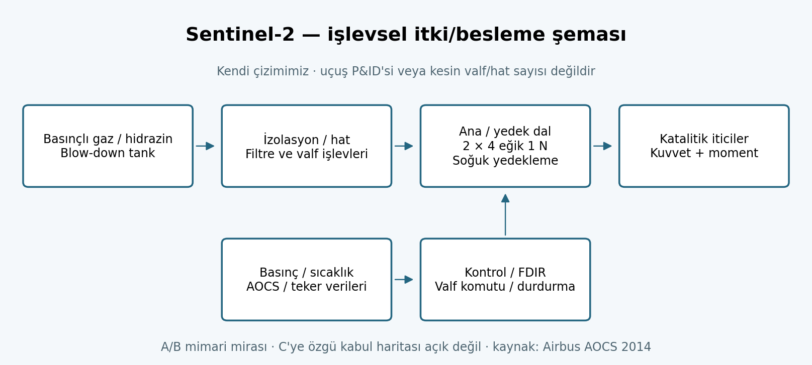

# Sentinel-2 serisi — A/B/C/D karşılaştırmalı itki incelemesi

**SASS / UZM 508E · Revizyon V4 · Kaynak kesiti: 29 Ekim 2026.**
İlk nesil Sentinel-2A/B/C/D karşılaştırılır; Next Generation ayrı programdır. Ayrıntılı C
dosyası: [Sentinel-2C](SENTINEL-2C.md). Denklemler ve yeniden üretim:
[HESAPLAR.md](HESAPLAR.md). Tam kaynak bağlantıları: [KAYNAKLAR.md](KAYNAKLAR.md).

**K:** yayımlanmış doğrudan bilgi; **M:** aile/tasarım/katalog mirası; **H:** hesap;
**V:** varsayım; **A:** açık veri ihtiyacı. Tasarım, dolum, uçuşta kalibre edilmiş ΔV
ve hesaplanan yakıt birbirinden ayrılmıştır.

## A. Genel görev ve seri farkları

### A1. Amaç, operatör ve üretici

Copernicus Sentinel-2, kara/bitki örtüsü, su, kıyı, tarım ve afet izleme için pasif
çok bantlı optik görüntüleme görevidir. Avrupa Birliği programı kapsamında ESA tarafından
geliştirilir ve işletilir; uçuş kontrolü ESOC'tur. Uydu ana yüklenicisi Airbus Defence
and Space Almanya, MSI yüklenicisi Airbus Defence and Space Fransa'dır. [S2-ESA]

MSI 13 spektral bantta, 443–2190 nm aralığında, 290 km şeritte çalışır: dört bant 10 m,
altı bant 20 m, üç bant 60 m yer örnekleme aralığına sahiptir. Nominal tek araç 10 günlük,
180° fazlı iki araç 5 günlük ekvator tekrarını sağlar. Bulut, Güneş yüksekliği, enlem
ve planlı görev kesintileri kullanılabilir görüntü tekrarını değiştirir. [S2-ESA]

### A2. Gerçek görev fotoğrafı

**Araç C'dir.** [ESA, Fuelling Sentinel-2C](https://www.esa.int/ESA_Multimedia/Images/2024/08/Fuelling_Sentinel-2C).
Kredi: **ESA-CNES-Arianespace / Optique vidéo du CSG – S. Martin**; ESA Standard Licence,
ek izin gerekebilir. Fotoğraf üzerinde işlem yapılmadı; görev fotoğrafı olarak sunuldu.

### A3. A/B/C/D karşılaştırması ve fiziksel veriler

| Özellik | Sentinel-2A | Sentinel-2B | Sentinel-2C | Sentinel-2D |
|---|---|---|---|---|
| Fırlatma, UTC günü | 23 Haziran 2015 | 7 Mart 2017 | 5 Eylül 2024 | Henüz fırlatılmadı |
| Fırlatıcı / uçuş | Vega / VV05 | Vega / VV09 | **Vega / VV24**, son özgün Vega | Bu incelemede atanmadı |
| Araç kütlesi | 1130 kg, Arianespace yazarlı kit aynası [K] | Aile 1140 kg; araç kabul değeri burada doğrulanmadı [M/A] | **1143 kg**, resmî kit [K] | Uçuş kabul kütlesi açık [A] |
| İtici | ESA A/B işletme tarifinde 123 kg [M] | Aynı tarifte 123 kg [M] | **133 kg N₂H₄**, 16.08.2024 dolumu [K] | C'nin 133 kg'ı kopyalanmadı [A] |
| Gaz/basınç | Blow-down aile mirası; araç dolum kaydı açık | Aynı | **He, 21 bar tank dolumu** [K] | Açık |
| 29.10.2026 durumu | Ek görüntüleme kampanyası; 31.12.2027'ye uzatıldı | Nominal B/C çiftinin üyesi | 21.01.2025'te A'nın nominal görevini devraldı | 2026 ESA sunumu: FAR başarılı, depoda |

Kaynaklar: [S2-ESA, S2A-VV05, S2B-OPS, S2-VV24, S2-FUEL, S2-EXT, S2-CDSE-DOC,
ESA-FUTUREEO-2026 s.27]. VV09 resmî kitinin eski URL'si HTTP 410 döndürdü; bu yüzden
B için ikincil bir rakam kesin uçuş kütlesi diye seçilmedi. WMO'daki ≥2028 planı bir
fırlatma garantisi değildir. ESA'nın depolama kabul bilgisi, C verisinin D'nin uçuş
kabul haritası olarak kullanılmasını sağlamaz.

| Aile/tasarım parametresi [M] | Değer / sınır |
|---|---|
| Görev yörüngesi | 786 km SSO, 98,62°, LTDN 10:30 |
| Uydu katlı zarfı | 3,4 × 1,8 × 2,35 m |
| EPS | 7,2 m² güneş dizisi, 1700 W EOL; 87 Ah batarya; 1,4 kW nominal tüketim (2012) |
| Haberleşme/veri | X-bant ve Tesat optik röle terminali; 2,4 Tbit tasarım belleği |
| Tasarım ömrü | Aile 7,25 yıl; sarf/batarya 12 yıllık tasarım; C kitinde 7 yıl tasarım, en az 10 yıl beklenen işletme |
| Eski kütle sürümleri | SP-1322/2 Ek C: 1200 kg/117 kg; ana metin 1225 kg içinde 70 kg marj; 2014 AOCS: 1225/130 kg |

Bu eski tasarım sayıları aynı gün tartılmış bir araç ve yakıt çifti değildir. 1143/133
C dolum çifti ile ayrı tutulur; "130 kg tasarım" ve "133 kg yüklenen" farkından gerçek
3 kg görev rezervi çıkarılmaz. [S2-SP1322, S2-AOCS, S2-WIKI]

### A4. Fırlatma ve bütün sistem sınırı

A/B/C; CSG Kourou'dan özgün Vega ile taşındı. Zincir **P80 → Zefiro-23 → Zefiro-9 →
yeniden ateşlenebilir AVUM → adaptör → uydu**. İlk üçü katı motor, AVUM sıvı üst kademedir.
Vega-C'nin P120C/Z40/AVUM+ zinciri bu uçuşların üstüne yazılmaz.

A için VV05 kitinin hedefi 786 km/98,5°, rampa SLV, nominal ayrılma T+54:43'tür. B için
görev yörüngesi aile değeridir; gerçek enjeksiyon durum vektörü bu incelemede yoktur.
C için hedef **775 km/98,57°**; gerçek edinim çalışmasında nominalin **10,6 km altında**
enjeksiyon bildirilir. Görev yörüngesiyle enjeksiyon hedefi eşit kabul edilmez.

C başlangıç denemesi elektrik sorunu nedeniyle ertelendi; gerçek kalkış **5 Eylül 2024
01:50 UTC**, ayrılma **T+57:27**. Resmî kitin nominal ayrılması T+57:33 ve Z9 ayrılması
T+6:32'dir. Eski kit aynası/ön duyuru tarihi gerçek uçuş sonucu değildir. İlk iletişim
Antarktika Troll üzerinden alındı; panel açıldı ve LEOP sonrası edinim başladı.
[S2-VV24, S2-ARI-RESULT, S2-DELAY, S2-ESA-LEOP]

Fırlatıcı ve üst kademenin Dünya yüzeyinden sağladığı enerji, uydunun hidrazin hesabına
dahil edilmez. AVUM'un ayrılma sonrası bertaraf ateşlemesi uydu CONOPS'una arayüz olayı
olarak yazılır; 133 kg defterinden düşülmez. D için uçuş henüz olmadığından tarih,
rampa, enjeksiyon ve gerçekleşen üst kademe manevrası uydurulmaz.

### A5. Operasyon ve genel değerlendirme

2026 nominal ikilisi B/C'dir. A'nın uzatma kampanyası ve yaklaşık 36° faz konumu,
üç aracın eşit 120° aralıklı olduğu anlamına gelmez; **evrensel 3,33 gün tekrar** iddiası
çıkarılamaz. 21 Ocak 2025 devri, A'nın o gün fiziksel olarak pasifleştirildiğini göstermez.
2025 C kesintisi veya MSI dekontaminasyonu da kalıcı görev sonu değildir.
[S2-WIKI, S2-EXT, S2-ANOMALY, S2-DECON]

Serinin propulsion açısından ayırt edici değeri: düşük ortalama düzlem içi bakım ΔV'sine
karşın tandem kalibrasyon ve yerel saat/eğim kontrolünde farklı büyüklük ve sürelerde
manevralar gerekir. Tek bir "yıllık m/s" değeri bütün görev evrelerini temsil etmez.

## B. Bütçeler

### B1. Kütle bütçesi

C: 1143 − 133 = **1010 kg** [H], hidrazin dışındaki bütün kütle; helyum dahil olabilir,
doğrulanmış kuru kütle değildir. ArianeGroup 1 N birim kütlesi 290 g olduğundan sekiz
itici 2,32 kg'lık alt küme oluşturur [M/H]; tank/hat/izolasyon/ısıtıcı/montaj hariçtir.
MSI'nin 2012 tasarım değeri 290 kg ile 2A için WMO 275 kg farklı sürümlerdir. C'nin
tam kütle kapanışı bunlardan keyfî çıkarma yaparak elde edilmez.

### B2. Güç bütçesi

1700 W EOL üretim ile 1400 W nominal tüketim arasındaki 300 W fark, kullanılabilir
yörünge enerji marjı değildir. Güneşin görüldüğü süre, dizinin açı/degradasyonu,
şarj-deşarj verimi, mod profili ve batarya sınırları gerekir. 87 Ah × gerilim × izin
verilen deşarj derinliği ile kullanılabilir Wh bulunur; gerilimi varsaymadan Ah'den
Wh'ye geçilmez. 2014 AOCS belgesindeki 28 V bus değeriyle yapılacak örnek, açıkça
o sürüme aittir; C'nin doğrulanmış batarya karakterizasyonu sayılmaz.

β=0 dairesel geometri örneğinde 786 km'de T≈100,58 dk, tutulma≈35,15 dk. Sürekli
1400 W tüketim ve Güneş'te tam 1700 W üretim **varsayılsa**, kayıpsız bile yörüngede
yaklaşık 2347 Wh tüketim ve 1854 Wh üretim çıkar; profil kapanmaz. Bu, gerçek uydunun
enerjisinin yetmediğini değil, **nominal mod gücünün bütün tura körlemesine yayılamayacağını**
gösterir. Gerçek EPS bütçesi mod ve mevsim üzerinden kapatılır.

### B3. Pointing bütçesi

2014 AOCS gereksinimleri: mutlak yönelim hatası 1200 µrad/eksen (%99,7), yönelim bilgisi
10 µrad/eksen (%95,5), hız hatası 20 µrad/s (%99,7), yatay konum bilgisi 12 m (%99,7),
GCP olmadan jeolokasyon 20 m (%95,5). Güven düzeyleri farklıdır; doğrudan RSS yapılmaz.
2012 konum gereksinimi 20 m/3σ ayrı sürümdür. [S2-AOCS, S2-SP1322]

Nadirde yalnız geometri için 786 km × 10 µrad = **7,86 m** [H]. 10 µrad/2σ ve
20 m/3σ kalemleri bağımsız Gaussian **varsayılırsa**, 1σ RSS≈7,74 m, 2σ≈15,48 m
çıkar. Bu tam uçuş pointing bütçesi değildir: hizalama, jitter, termal boresight,
kenar bakış açısı, DEM ve korelasyon yoktur. İtici eğikliği AOCS torkuna hizmet ederken
eksenel yakıt etkinliğini düşürür.

### B4. Link bütçesi ve B5. Veri bütçesi

2012 yayımlanan X-bant hızı 560 Mbit/s, sonraki aile tarifinde 520 Mbit/s olabilir;
kanal/ürün/kodlama tanımları ve sürüm belirtilir. S-bant TT&C, X-bant yük verisi ve
optik EDRS ayrı arayüzlerdir. Uçuş EIRP, istasyon G/T, kodlama eşiği ve bütün kayıplar
olmadan gerçek link marjı hesaplanamaz. [S2-SP1322, S2-WIKI]

2,4 Tbit bellek = **300 GB** (ondalık). 600 s'de 560/520 Mbit/s ideal sınır
**42/39 GB**; 300 GB'ı 560 Mbit/s'de boşaltmak **71,43 dk** sürer. Tam kapasite bellek
tek kısa geçişte boşalmaz. Net yük hızında protokol verimi ve istasyon sürekliliği
uygulanmalıdır. Eski ESA operasyon sayfasındaki "1,6 TB/tur" ifadesi bellek ve günlük
ifadelerle tutarsız göründüğü için birimi sessizce Tb'ye değiştirilmedi veya kesin
üretim oranı seçilmedi. [S2-OPS]

### B6. Isıl bütçe

MSI optik yapısı, yıldız izleyicilerin teleskop üzerindeki hizası, yakıt tankı/hatları
ve katalizör ön ısıtması birlikte değerlendirilir. Aile tarifinde yıldız izleyiciler
ve jiroskop teleskop yapısına monte edilir. `Q_giren − Q_çıkan = dU/dt` için Güneş,
albedo, Dünya IR, iç kayıplar, radyatör özellikleri ve bağlantı iletkenliği gerekir.
300 W, ε=0,8, T=300 K ve yalnız derin uzaya bakış **varsayımıyla** radyatör yaklaşık
0,82 m² olur [H/V]; gerçek C radyatör alanı veya termal marj değildir.

### B7. ΔV bütçesi ve B8. Faydalı yük / alt sistemler

MSI, OBC, kütle belleği, güç ve termal kontrolün yanında; AOCS aile tarifinde üç yıldız
izleyici, IMU, çift GNSS, dört teker ve üç manyetik tork çubuğu bulunur. İtki modülü
bağımsız test edilebilen tank/hat/itici bütünüdür ve fırlatıcı arayüz halkası içine
yerleştirilir. Açık erişimli 2009 EADS çalışması mimariyi destekler; o tarihteki 1100/133 kg
ve 1,7 Tbit değerleri C uçuş verisi sayılmaz. [S2-AOCS2009, S2-SP1322]

ΔV defteri edinim, fazlama, tandem, IP bakım, OOP/yerel saat, CAM, güvenli mod ve EOL
kalemlerini izlemelidir. Güvenli mod yakıtı yalnız orbital ΔV'den çıkarılamaz; karşılıklı
tork üreten darbeler yakıt tüketip yaklaşık sıfır translasyon verebilir.

## C. CONOPS ve yayımlanmış manevra defteri

| Evre | C için tarih / eylem | ΔV kaynağı ve sınırı |
|---|---|---|
| Yer | 16.08.2024 dolum, latch valf kapama | Orbital ΔV yok |
| Fırlatma | 05.09.2024 Vega/AVUM → ayrılma | Uydu yakıtına eklenmez |
| LEOP / edinim | Alçak enjeksiyondan doğal faz sürüklenmesi; 4 büyük IP manevra | Yaklaşık 6,33 m/s, toplu yayımlanmış değer |
| İnce edinim | 29 ve 31 Ekim küçük düzeltmeler | 0,012 ve 0,0146 m/s; 31 Ekim aşağıdaki tabloya dahil |
| İlk OOP düzeltmeler | LEOP sonrası ve bir ay sonra | Yaklaşık 0,57 m/s toplu değer |
| Tandem | 31.10–19.12.2024; A/C çapraz kalibrasyon | Tablo 3'te 8 olay, 1,05644 m/s |
| Nominal | 21.01.2025'ten itibaren B/C ikilisi | IP + OOP + CAM; tek yıllık toplam açık değil |
| A'nın ek kampanyası | Nominal yuvadan çıkarma ve ek gözlem | C'nin yakıt defterinden düşülmez |
| EOL | Bilim sonu → alçaltma → pasivasyon | 2014 aile planı; C'nin güncel kabul edilmiş tahsisi açık |

### C1. Gerçek C manevraları: kalibre edilmiş ΔV

| UTC tarih | Süre (s) | Bileşenler (m/s) | Muhasebe |
|---|---:|---:|---|
| 31.10.2024 | 5,3 | IP +0,0146 | İnce edinim; bir kez sayılır |
| 06.11.2024 | 314,1 | OOP 0,9344; IP +0,0537 | Tek yanma, norm **0,93594** |
| 08.11.2024 | 0,9 | IP +0,0025 | Touch-up |
| 23.11.2024 | 7,3 | IP −0,0207 | CAM gidiş |
| 23.11.2024 | 7,3 | IP +0,0206 | CAM dönüş; yakıt maliyeti iptal olmaz |
| 27.11.2024 | 11,0 | IP +0,0309 | Bakım |
| 29.11.2024 | 1,0 | IP +0,0029 | Touch-up |
| 18.12.2024 | 10,0 | IP +0,0283 | Bakım / ayrışma başlangıcı |

Kaynak: [S2-SPACEOPS617, s.15–17, Tablo 3]. Komutlanan büyüklükler yerine kalibre edilmiş
olanlar kullanılır. Toplam maliyet `Σ||Δv_i||`; net vektör toplamının normu değildir.
Toplu edinim kalemleriyle **6,33 + 0,012 + 0,57 + 1,0564418 = 7,9684418 m/s** [H].
İlk OOP kaleminde makale planlama dili kullanır; toplam tam telemetri değil, yayımlanmış
özetin rekonstrüksiyonudur. Kaynak yaklaşık değerler verdiğinden **yaklaşık 7,97 m/s** olarak
yazılır; sekiz ondalık uçuş kesinliği ima edilmez.

Tandem sonunda bildirilen performans yaklaşık **27,50±0,25 s** ayrım, 50 gün boyunca
100 m'den küçük yer izi farkıdır. Bunlar gerçekleşen dönem sonuçlarıdır; başlangıç
planındaki 28 s veya ±200/700 m hedefleriyle aynı tür bilgi değildir.

### C2. A'dan öğrenilen bakım ve CAM maliyeti

SpaceOps #617'de 2015–2024 dönemi 64 IP bakım, ortalama 1,56 cm/s: toplam yaklaşık
0,9984 m/s, yaklaşık 8,7 yıla bölünürse **0,115 m/s/yıl** [H]. Bu **yalnız IP**
istatistiğidir; C'nin tam yıllık bütçesi değildir. 24 CAM çifti ve yaklaşık 0,04 m/s
ortalama tek manevra büyüklüğü ayrı istatistiktir. On CAM aynı zamanda bakım için
optimize edilmiştir; kategoriler örtüşebildiği için bu özetler körlemesine toplanmaz.
[S2-SPACEOPS617 s.5]

### C3. İtki hatası → tandem sürüklenmesi türetimi

Dairesel küçük teğetsel hata için `δa≈2aδv/v`; `δn/n≈−3δa/(2a)` olduğundan,
`|δt_faz|≈3|δv|Δt/v`. Dönen Dünya yer izi yaklaşımıyla
`|δXT|≈ωE RE |δt_faz|`. 786 km'de 1 cm/s hata bir günde yaklaşık **0,347 s** ve
**161,6 m**; 3,85 cm/s yaklaşık **622 m** üretir [H]. Makalenin yuvarlanmış
0,342 s / 160 m / 614 m örnekleriyle fark %2'nin altındadır. Bu kontrol bağımsız
ölçüm doğrulaması değil, birinci mertebe model karşılaştırmasıdır.

Zamanı ayarlanmış eş manevralar ve touch-up, kontrolsüz sürüklenmeyi azaltır. Tek
yanma büyüklüğünden bütün 50 günlük ayrımı tahmin etmek; eş yanma ve sonraki
düzeltmeleri yok sayar. Yayınlanan gerçek tandem performansı bu basit serbest
sürüklenme hesabına eşitlenmez.

## D. Propulsion: mimari ve ayrıntılı hesap

### D1–D3. Tip, yerleşim, donanım ve işlevler

Tek bileşenli hidrazin, helyumla basınçlandırılmış blow-down kimyasal itki. Aile/A-B
mimarisinde iki **soğuk yedekli** dal, her dalda dört eğik 1 N itici vardır. Yörünge
kontrolünde aktif dört itici birlikte çalışır; AOCS off-modulation ile torku düzeltir.
CHT1N-6 aile mirası ve ArianeGroup broşüründe A/B kullanımı belgeli; C'nin kabul edilmiş
seri numarası, cant açısı, tank hacmi ve giriş performans haritası açık değildir.
[S2-AOCS, S2-AG-THR]

Kendi çizimimiz işlevleri gösterir; gerçek borulama/valf sayısı için uçuş P&ID'si
değildir. İşlevler: enjeksiyon/faz hatası düzeltmesi, yer izi/eğim/yerel saat bakımı,
CAM, güvenli mod yönelimi ve bertaraf. Teker/manyetik torkla yapılan kontrol ile
kimyasal tüketim birbirine karıştırılmaz.

| ArianeGroup 1 N kataloğu [M] | Değer |
|---|---|
| Kuvvet | Nominal 1 N; 0,32–1,1 N aralığı |
| Isp | Nominal 220 s; 200–223 s aralığı |
| **Motor giriş** basıncı | 5,5–22 bar |
| Kütle debisi | Nominal 0,44 g/s; 0,142–0,447 g/s |
| Kalifiye toplam impuls / çevrim | 135000 N·s / 59000 |
| Yakıt geçişi / süre | 67 kg; 12 saat tek, 50 saat birikimli ateşleme |
| Soğuk başlatma | 10 başlatma, katalizör yatağı <10 °C şartında |
| Birim kütle | Valflerle 290 g |

Kaynak: [S2-AG-THR, PDF s.6]. C'nin **21 bar tank dolumu**, 21 bar motor girişi
demek değildir. Hat/valf kaybı, sıcaklık ve dinamik geçiş bilinmeden katalog zarfı
uyumu kanıtlanamaz. Katalog nominal 1 N, 220 s ve 0,44 g/s tek bir eşleşmiş ölçüm
noktası değildir: `0,00044×9,80665×220=0,9493 N`. Tam 1 N ve 220 s'de debi
**0,4635 g/s** olmalıdır; iki farklı nominal tanımı aynı denklemde zorla kapatılmaz.

### D4–D6. Tsiolkovsky, kuvvet, süre, yakıt

C'nin 133 kg'ı tamamen ideal kullanılırsa 200/220/223 s için **242,6 / 266,9 /
270,5 m/s** kapasite [H/V]. Gerçek kullanılabilir kapasite; gaz erişimi, hat kaybı,
itici yönelimi, off-modulation, başlangıç/geçişler ve kullanılmayan kalıntıyla azalır.
Bu değerler görev tahsisi değildir.

Yaklaşık 7,97 m/s'nin kademeli roket denklemiyle ideal tüketimi:

| Isp [V] | Etkin eksensel faktör [V] | Hesap yakıtı, yaklaşık |
|---:|---:|---:|
| 220 s | 1,0 | 4,21 kg |
| 200 s | 1,0 | 4,63 kg |
| 220 s | 0,8 | 5,26 kg |
| 200 s | 0,8 | 5,79 kg |

Bunlar **ölçülmüş tüketim değildir**; faktör 0,8 bir açı/duty kaydı değil, duyarlılık
varsayımıdır. Görev başından başlayan kütle defteri her manevradan sonra mi'yi azaltır.
6 Kasım için bu modelde yanma öncesi kütle yaklaşık 1139,3 kg; kalibre ΔV / 314,1 s
ile sabit etkin egzoz hızı yaklaşımında **yaklaşık 3,39 N** ortalama eksensel kuvvet
çıkar. Bu, dört motorun ölçülmüş ayrı kuvvet haritası değildir.

Eğer dört motorun her biri tam 1 N ve duty=1 olsaydı 3,39 N için cant yaklaşık 32°
olurdu. Her motor 0,85 N ise sıfıra yakın cant da mümkündür; duty ve AOCS düzeltmeleri
ayrıca etkilidir. **Bu tek manevradan gerçek montaj açısı belirlenemez.**

A'nın aynı dönemdeki 6 Kasım OOP manevrası 422,5 s, C'ninki 314,1 s'dir. Fark yaşlanma
ve blow-down ile uyumlu olabilir; kütle, komut ve yön farkları ayrıştırılmadan neden
yalnız basınç düşüşü olarak ispatlanmış sayılmaz. [S2-SPACEOPS617 Tablo 3–4]

### D7. EOL ve rezerv → koşullu ek ömür

Airbus 2014 aile planı: 786→653 km, **116×10 dk**, **73 m/s**, **47 kg**, 25 yıllık
yeniden giriş hedefi. İdeal iki impuls sonucu **70,22 m/s**, fark **%3,96** [H].
Kaynak bu farkın tamamını "sonlu yanma payı" diye açıklamadığından böyle adlandırılmaz.
47 kg ile ters çözümün etkin Isp'si, varsayılan EOL başlangıç kütlesine bağlıdır; 1057–1139 kg
aralığında yaklaşık 164–177 s. Nominal 220 s ile farkın nedeni tek başına bu sayılardan
bulunamaz; tasarım marjı, cant, blow-down ve ayrıntılı uçuş planı açık değildir.

`133 − 4,21 − 47 = 81,79 kg` yalnız **ideal tüketim + başka sürüm aile EOL planı**
üzerinden aritmetik bir kalan örneğidir. Güncel tank ölçümü, gerçek rezerv veya EOL
uygunluk teyidi değildir. Yıllık yalnız IP tüketimiyle bunu bölüp binlerce yıl sonucu
çıkarmak geçerli ömür hesabı olmaz. OOP, CAM, safe-mode, kullanılmayan kalıntı, basınç,
termal/valf/impuls ömrü, batarya ve optik yükün sağlığı da gerekir.

Ödevde "2,5 kg yerine 3 kg varsa kaç yıl?" sorusu için bugünkü toplam kütle m,
rutine ayrılabilecek ek yakıt p ve sabit yıllık toplam ΔVyıl tanımlanırsa
`Nideal = ce ln[m/(m−p)] / ΔVyıl`. EOL/emniyet yakıtı rutin boyunca taşınır ve m'nin
içinde kalır; çift düşülmez. Erişilebilir basınç ve diğer ömür kısıtları ayrıca gerekir.
Ayrıntılı örnek [hesap ekinde](HESAPLAR.md). Gerçek C için bütün girdiler olmadığından
kesin ek yıl atanmadı.

### D8. Anlık, sonlu veya sürekli

Aralıklı kimyasal ateşlemeler; elektrikli sürekli itki değil. 0,9–11 s bakım yanmaları
100,58 dakikalık tur yanında kısa; 314,1 s eğim yanması turun %5,2'si, EOL'deki
600 s parçalar %9,9'udur. Bu oranlar kontrol göstergesidir, kesin hata sınırı değildir.
Sonlu yanma doğrulaması thrust yönünü, kütleyi ve orbital fazı entegre etmelidir.

### D9. Güvenlik ve regülasyon

Hidrazin toksisitesi, yüksek basınçlı He, malzeme/conta uyumluluğu, katalizör ve valf
ısıl şartları, plume ve beklenmedik tork emniyet analizinin parçalarıdır. Yerdeki
dolumda kontrollü alan ve prosedürler uygulanır; bu rapor uygulama talimatı değildir.
2014'teki 25 yıl hedefi güncel kabul kanıtı sayılmaz. ESA'nın 2023 beş yıllık LEO
temizleme politikası için görev baseline'ı, geçiş ve uzatma değerlendirmesi gerekir;
"eski tasarım, otomatik muaf" sonucu çıkarılamaz. [S2-FUEL, DEBRIS-ESA-2023]

### D10. TRL ve sonraki kendi tasarımımıza çıkarım

A/B'nin uçuşu belgelenmiş motor ailesine miras sağlar; C'nin tekil seri numarası ve
uçuş öncesi TRL tutanağı açık değil. D'nin yerde FAR'ı geçmesi uçuşta gösterim değildir.
Sırf sonradan uçtu diye geçmişte TRL 6 etiketi atanmaz. Yeni motor+besleme bütünümüzde
görev gereksinimi, basınç ve sıcaklık zarfı, çevrim/impuls ömrü, cant/torque ilişkisi,
ayrılma sonrası erişilebilir gaz/yakıt, FDIR ve temsilî ortam deneyi gerekir.

## Kendi tasarımımız için henüz kapatılamayan veriler

Önce görev ΔV'si, araç kütlesi, yörünge/ömür, güç ve hacim seçilmelidir. Sonra modül
kuru kütlesi, tank hacmi/doluluk, gaz bütçesi, hat basınç kaybı, itici haritası,
minimum impuls biti, yerleşim/tork ve güvenli mod tüketimi istenir. Kamuya açık görev
çalışmalarının bu boşlukları, varsayımları ölçüm diye adlandırarak kapatılamaz.
